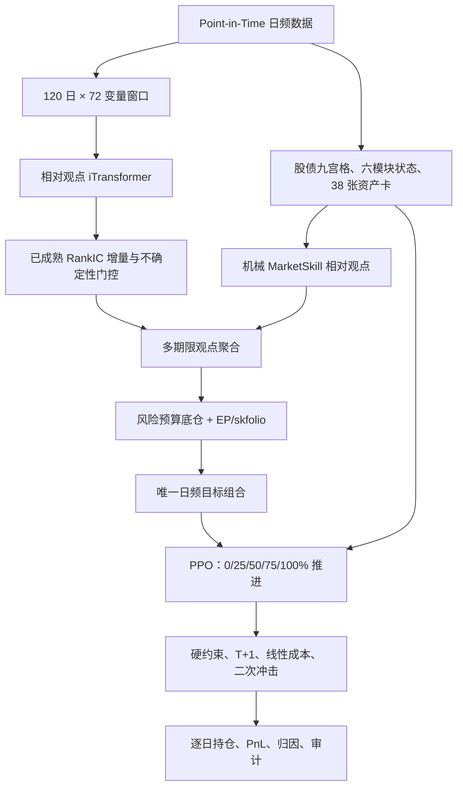

# 相对观点 iTransformer + 自适应执行 PPO v4

## 1. 策略定位

这不是让神经网络直接报仓位，也不是让 PPO 在资产之间自由下注。

完整思路是：

1. 风险预算先给出低波、中波、高波三类产品各自的长期底仓。
2. 股债九宫格、六模块状态和 38 张资产卡描述当时市场，并提供硬边界。
3. 机械 MarketSkill 给出可解释的相对观点。
4. iTransformer 只预测五个袖套未来相对强弱，不预测绝对收益，也不直接改仓位。
5. iTransformer 只提供相对因果动量基线的独有残差方向；只有历史调参段确实选择了非零残差权重，且当时已成熟表现满足绝对可靠性和非劣约束，它才进入 EP/skfolio。
6. EP/skfolio 生成当天唯一的目标组合。
7. PPO 不能改变目标方向，只能决定当天向目标推进 0%、25%、50%、75% 或 100%。
8. 信号在 T 日收盘后形成，最早在下一交易日执行，并扣除交易成本和冲击成本。



## 2. 三类产品

三类产品共享信号和模型，但底仓、袖套边界、主动偏离能力、风险惩罚和无交易区间不同。

| 参数 | 低波 | 中波 | 高波 |
|---|---:|---:|---:|
| EP 日频观点收益尺度 | 0.0015 | 0.0030 | 0.0050 |
| 最大主动偏离 | 1.0% | 2.2% | 4.0% |
| 最大袖套换手 | 3.5% | 7.0% | 11.0% |
| PPO 无交易 L1 区间 | 0.6% | 0.9% | 1.4% |
| 二次冲击系数 | 0.0010 | 0.0015 | 0.0020 |
| 下行/波动/回撤惩罚 | 最强 | 居中 | 最弱 |

产品差异来自风险预算与风险承受能力，不是给三类产品分别事后挑一段最优历史。

## 3. 输入数据

### 3.1 核心文件

| 文件 | 用途 |
|---|---|
| `data_processed/feature_panel_daily_v43.parquet` | 利率、信用、资金、转债、权益估值、商品和海外宏观特征 |
| `data_processed/asset_returns_daily.parquet` | 正式资产及代理资产的日收益和可用 OHLCV |
| `data_processed/market_state_cards_daily_v1.parquet` | 股债九宫格、六模块状态、38 张资产卡和硬过滤条件 |
| `data_processed/market_skill_views_mechanical_daily_v1.parquet` | 无 LLM 的可审计相对 Market Views |
| `data_processed/v1_{profile}_risk_budget_base_monthly.parquet` | 三产品风险预算底仓 |
| `data_processed/v1_{profile}_sleeve_weights_monthly.parquet` | 正式袖套锚 |
| `data_processed/v1_{profile}_target_weights_monthly.parquet` | 正式资产锚和袖套收益聚合口径 |

30 年利率债继续使用 `rate_30y_curve_proxy`。它由 30 年国债收益率变化、18.5 修正久期和过去可见 carry 构造，不把 2024 年后上市 ETF 的价格倒填到 2018 年。

### 3.2 iTransformer 的 72 个变量

模型窗口为最近 120 个中国交易日。

变量由四组组成：

| 组别 | 数量 | 内容 |
|---|---:|---|
| 宏观与估值水平/20 日变化 | 32 | 10Y/30Y 利率、AAA/AA 信用利差、DR007、Shibor、转债价格/溢价、权益 PE/PB、美债、美元、南华商品、黄金、实际利率、REITs 分派率 |
| 五袖套价格路径 | 30 | 每个袖套的 1 日收益、20/60 日动量、20/60 日波动和 60 日回撤 |
| OHLCV 结构 | 6 | 覆盖合格的信用、权益、另类收盘区间位置中位数与离散度 |
| 补充高质量字段 | 4 | 转债/权益成交额和较长周期风险字段，由最早训练区间的缺失率与方差确定 |

特征列表写入：

`output/reports/itransformer_daily_timing_v3_metadata.json`

特征选择先保留经济上必须存在的组别，再用最早训练区间的数据质量补足名额。这样不会再出现 32 个宏观字段把收益、动量、波动和回撤全部挤掉的问题。

### 3.3 Point-in-Time 预处理

- 每个特征只使用截至当日的尾部窗口做稳健标准化。
- 快变量使用较短历史，慢变量使用较长历史。
- 滚动样本不足时只使用截至当日的 expanding 历史，不在全样本上 fit scaler。
- 缺失值先保留可用性信息，再在模型张量中填 0。
- 所有预测标签从下一交易日开始。

## 4. 相对观点 iTransformer

### 4.1 标签

对期限 \(h\in\{5,20,60\}\) 和袖套 \(i\)，先计算：

```text
未来 h 日复合收益
- 过去 252 日均值推导的预期收益
---------------------------------
过去 60 日波动 × sqrt(h)
```

再在五袖套截面去均值。模型因此学习“谁相对更强”，不学习不可比的绝对收益水平。

神经网络拟合的是相对因果动量基线的残差：

```text
target_residual = realized_relative_score - baseline_relative_score
```

最终观点为：

```text
baseline + residual_alpha × predicted_residual
```

`residual_alpha` 只能在对应 fold 的历史调参段内从
`[0, 0.05, 0.10, 0.15, 0.25]` 选择。

### 4.2 网络结构

| 参数 | 数值 |
|---|---:|
| 输入 | 120 日 × 72 变量 |
| 输出 | 3 期限 × 5 袖套 = 15 个相对分数 |
| `d_model` | 32 |
| 注意力头 | 4 |
| Encoder 层 | 1 |
| FFN | 128 |
| Dropout | 0.35 |
| 参数量 | 24,737 |

每个变量是一枚 token。`Linear(120 -> 32)` 将该变量完整的 120 日路径投影到 token，变量身份 embedding 防止模型把不同指标当成可交换序列。15 个袖套/期限 query 通过 cross-attention 从变量 token 中读取信息。

### 4.3 训练参数

| 参数 | 数值 |
|---|---:|
| 最大 epoch | 1000 |
| batch size | 64 |
| 学习率 | 0.00025 |
| weight decay | 0.005 |
| early-stopping patience | 60 |
| 最小改善 | 0.0001 |
| 随机种子 | 17、42、73 |

1000 是上限，不是必须使用最后一轮。模型选择只看时间顺序验证集，保存验证最优 checkpoint。训练损失继续下降而验证损失恶化时必须早停。

### 4.4 Walk-forward

| 预测年度 | Fit 截止 | Tune 截止 | Evaluation 截止 |
|---|---|---|---|
| 2022 | 2020-12-31 | 2021-12-31 | 2022-12-31 |
| 2023 | 2021-12-31 | 2022-12-31 | 2023-12-31 |
| 2024 | 2022-12-31 | 2023-12-31 | 2024-12-31 |
| 2025 | 2023-12-31 | 2024-12-31 | 2025-12-31 |

2026 年按季度重训。训练样本的最长标签结束日必须早于季度开始日。每一行预测同时保存 `model_training_cutoff` 和 `prediction_source`，供回测审计。

## 5. iTransformer 观点门控

对每个期限，在真实结果成熟后计算当天五袖套的截面 RankIC：

```text
incremental_reliability
= rolling_mean(model_rank_ic, 120)
- rolling_mean(baseline_rank_ic, 120)
```

保存的 OOS 模型分数已经是
`baseline + selected_residual_alpha × predicted_residual`。进入配置器时只提取
`model_score - baseline_score` 作为 iTransformer 的独有观点，不能把完整模型分数再与动量基线混合一次，否则会重复计算动量并把残差信号二次压缩。

约束：

- 至少有 40 个已经成熟的观察。
- 对应历史调参段选择的 `residual_alpha` 至少为 0.05；为 0 时模型严格关闭。
- 模型滚动 RankIC 至少为 0.02。
- `incremental_reliability >= -0.01`，即只允许很小的滚动非劣容忍，不要求每个时点都显著战胜动量。
- `residual_alpha=0.25` 对应完整的 alpha 置信度，较小 alpha 按比例收缩。
- 增量可靠性为 0 时，边际置信度为 0.75；降至 -0.01 时降为 0.25；正增量达到 0.12 时升至 1。
- 袖套残差分数截面必须非退化，标准化后极差至少为 0.08。
- 正向观点还要经过股债九宫格兼容度和硬阻断条件。

历史回测不能使用全样本结束后才知道的总研究门。历史权重只由当时已经成熟的滚动可靠度决定。全样本研究门仅用于判断最新版本能否正式晋升。

## 6. 多期限聚合

通过门控的期限按以下基础权重聚合：

```yaml
5日:  0.20
20日: 0.50
60日: 0.30
```

实际权重还要乘以该期限当时的可靠度置信度。各期限置信度的加权和还会直接缩放模型观点总振幅，防止只有一个低置信期限时被归一化成满额观点。期限之间分歧越大，模型观点整体缩得越多：

```text
uncertainty_multiplier
= clip(1 - mean_cross_horizon_std / 0.75, 0, 1)
```

因此 5/20/60 日只是三个预测视角，不是固定持有期，也不规定下次调仓日。

## 7. MarketSkill、九宫格与目标组合

机械观点和模型观点先在袖套截面标准化：

```text
fused_view
= 1.00 × mechanical_rule_view
+ 0.60 × gated_itransformer_view
```

股债九宫格的职责不是替代模型，而是提供边界：

- 不兼容的正向观点被衰减。
- 九宫格明确阻断的利率、信用、转债或权益方向不能被模型强行打开。
- 流动性冲击时，转债和权益不能高于风险预算底仓。
- 63/126/252 日趋势显著转弱时，转债、权益和另类只能按产品限额减仓。

## 8. EP/skfolio

EP/skfolio 每日只生成一个目标，不向 PPO提供多个方向候选。

输入：

- 当日风险预算底仓。
- 融合后的五袖套相对观点，作为 posterior mean。
- 截至当日的 252 日袖套收益协方差。
- 三产品袖套上下限和主动偏离约束。

协方差只描述风险，不接收 iTransformer 风险观点。iTransformer 只进入均值观点，避免预测信号同时改写收益和风险两条通道。

求解器使用 `skfolio MeanRisk + CLARABEL`。历史不足 60 日或求解失败时，自动退回风险预算底仓。

## 9. PPO 自适应执行

### 9.1 动作

```text
0.00 = 保持当前仓位
0.25 = 向今日唯一目标推进 25%
0.50 = 推进 50%
0.75 = 推进 75%
1.00 = 完整推进到今日目标
```

PPO 不选择资产、不选择多空方向、不选择 5/20/60 日期限，也不能输出任意连续仓位。低置信度时直接回退确定性 threshold 动作，不再做连续比例安全混合。

### 9.2 状态

控制器读取：

- 股债九宫格、状态持续时间和状态切换。
- CR/R/CB/EQ/ALT/RB 六模块状态。
- 五袖套资产卡均值与离散度。
- 机械观点数量、置信度和袖套方向。
- 三期限的已成熟增量可靠度、观点分差和九宫格一致性。
- 当前仓位相对风险预算的主动偏离。
- 当前仓位到今日目标的距离。
- 今日目标相对昨日目标的变化。
- 距上次有效调仓的天数和上次动作。
- 相对正式锚的 EWMA 超额收益、波动和回撤。

状态列禁止包含 `realized`、`label`、`forward`、`future` 和 `next_return`。

### 9.3 奖励

基础奖励为策略相对正式锚的当日净收益，另扣：

- 相对下行恶化。
- 相对 EWMA 波动恶化。
- 相对回撤恶化。
- 10bp 线性换手成本。
- 按产品区分的二次冲击成本。

不再使用线性“距离目标越远惩罚越大”的项，因为它会机械地把动作压到 0% 或 100%，破坏中间动作的含义。

### 9.4 训练与部署

- 状态历史从 2018 年开始。
- 2023 年开始逐年扩展 walk-forward 部署。
- 每年只用该年 1 月 1 日前可执行的历史。
- 最后 25% 为时间顺序验证集。
- 训练与验证之间 purge 60 个交易日。
- purge 后至少保留 504 个训练日。
- 验证集分为三个连续区块。
- PPO 最大 1000 epoch，KL 上限 0.012，梯度裁剪 0.5，early-stopping patience 20。
- PPO 正式训练前先做 60 epoch 行为预训练。教师标签只在已隔离训练段内比较五档动作的次日奖励；状态路径仍沿因果 threshold 策略推进，验证段和部署段从不使用 oracle 标签。
- checkpoint 先满足“至少 2/3 连续验证区块为正且中位超额为正”的部署约束，再在合格集合内按含最差区块惩罚的稳健分数择优。未合格的 0 超额 hold 模型不能覆盖已经合格的 checkpoint。
- 随机种子为 17、29、47。
- 至少两个种子通过验证门且动作一致，PPO 才能覆盖 threshold。
- 动作概率和领先次优概率差必须同时过门。
- 任一条件失败都自动使用 threshold。

## 10. 回测执行

- 信号日：T。
- 执行日：下一中国交易日。
- 组合在执行后按资产收益自然漂移。
- 现金权重固定为 0。
- 权重和必须为 1。
- 袖套上下限逐日检查。
- 调仓成本进入当天收益，不能只在报告中事后展示。

## 11. 正式门

代码正确不等于模型有效。正式晋升还必须同时满足：

- iTransformer 全样本研究门通过。
- 2024 年以来相对 threshold 的年化收益不为负。
- Sharpe 增量不为负。
- 最大回撤恶化不超过 0.3%。
- 20 日成对区块 Bootstrap 中，收益增量为正概率至少 60%。
- Sharpe 增量为正概率至少 55%。
- 分年度超额收益为正的比例至少 60%。
- 所有因果、T+1、权重、成熟度和动作审计通过。

正式门失败时仍保留所有结果用于研究，但 `production_promotion_allowed=false`。

## 12. 运行方式

完整一键运行：

```powershell
& 'C:\Users\lenovo\AppData\Local\Programs\Python\Python312\python.exe' scripts\153_run_relative_itransformer_execution_ppo_v4.py
```

已有 72 变量数据集，只重训模型和 PPO：

```powershell
& 'C:\Users\lenovo\AppData\Local\Programs\Python\Python312\python.exe' scripts\153_run_relative_itransformer_execution_ppo_v4.py --skip-dataset
```

已有 iTransformer 预测，只重训 PPO：

```powershell
& 'C:\Users\lenovo\AppData\Local\Programs\Python\Python312\python.exe' scripts\153_run_relative_itransformer_execution_ppo_v4.py --skip-dataset --skip-itransformer-training
```

快速结构测试：

```powershell
& 'C:\Users\lenovo\AppData\Local\Programs\Python\Python312\python.exe' scripts\154_smoke_test_relative_view_v4.py
```

## 13. 主要输出

| 输出 | 含义 |
|---|---|
| `data_processed/itransformer_daily_timing_v3_residual_robust_predictions.parquet` | 三期限、五袖套严格 OOS 相对观点及训练截止日 |
| `output/reports/itransformer_daily_timing_v3_residual_robust_training_log.csv` | iTransformer 每轮训练/验证损失 |
| `output/reports/itransformer_daily_timing_v3_residual_robust_cv_report.csv` | 各 fold RankIC 与基线比较 |
| `output/reports/itransformer_daily_timing_v3_residual_robust_gate.json` | iTransformer 研究门 |
| `data_processed/view_execution_ppo_v4_state.parquet` | PPO 的无未来状态表 |
| `data_processed/view_execution_ppo_v4_{profile}_decisions.parquet` | 每日动作、置信度、目标诊断、换手和成本 |
| `output/reports/view_execution_ppo_v4_{profile}_daily.csv` | 逐日 PnL、NAV 和对照 |
| `output/reports/view_execution_ppo_v4_three_profile_summary.csv` | 三产品绩效汇总 |
| `output/reports/view_execution_ppo_v4_paired_block_bootstrap.csv` | 相对 threshold 的不确定性检验 |
| `output/reports/view_execution_ppo_v4_formal_gate.json` | 最终正式晋升结论 |
| `output/reports/view_execution_ppo_v4_method_and_results.md` | 自动生成的方法与结果报告 |
| `output/reports/view_execution_ppo_v4_layer_ablation.csv` | 正式锚、机械观点、iTransformer、PPO 四层消融 |
| `output/reports/view_execution_ppo_v4_layer_ablation.md` | 四层消融的可读结论 |

## 14. 当前验证状态

截至 2026-07-25：

- 72 变量数据集已生成，共 1,954 个日频窗口，1,888 个有完整标签的窗口。
- 模型输入为 `120×72`，输出为 15，前向计算有限且参数量为 24,737。
- iTransformer CV 中位 RankIC 为 0.1113，因果动量基线为 0.1156，增量为 -0.0043；walk-forward holdout RankIC 为 0.01875，低于 0.02 门槛。因此全样本 iTransformer 研究门失败。
- 三产品使用 3 个种子、年度扩展窗口和最多 1000 epoch 完成全量 PPO 训练；所有因果、T+1、权重、成熟度和离散动作审计通过，共 30/30。
- 2024 年以来策略年化收益约为 6.44% / 7.61% / 12.97%，Sharpe 为 3.29 / 2.57 / 1.70，最大回撤为 -1.58% / -2.23% / -6.59%，低、中、高风险层级成立。
- 低波和高波没有 PPO 部署日；中波只有 63/2035 个交易日由 PPO 执行，其余均为 threshold 或其他确定性 fallback。
- 四层消融显示，iTransformer 相对纯机械 EP 仅增加约 0.04bp / 0.53bp / 0.76bp 年化和 0.0004 / 0.0011 / 0.0018 Sharpe，独立增量接近零。
- PPO 仅对中波增加约 6.48bp 年化和 0.0142 Sharpe；低波、高波增量为零。
- 当前 `production_promotion_allowed=false`。原因是模型增量不足和跨年度稳定性不足，不是工程链失败；正式版本继续保留确定性 threshold fallback。
