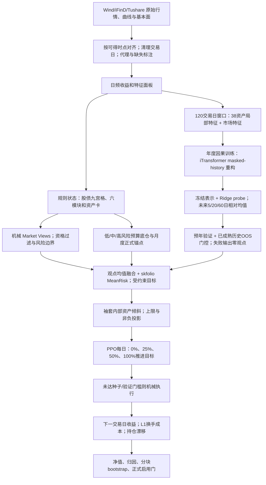
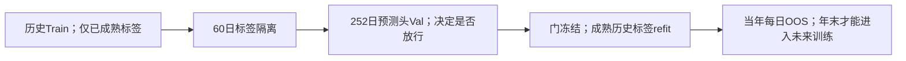

# 固收+项目复审、真实架构与术语说明

更新：下文保留修复前审阅证据。v44已修复主要会计、协方差接入与目标函数问题并完成PPO重训，但后续边界审查发现绑定换手、可行性和失败回退等求解器契约仍待修复，不能称为全部求解器问题已解决。当前状态见 `v44_accounting_repairs_20261014.md`，新设计见 [v45完整方案](v45_solver_prediction_execution_plan_20261014.md)。v45尚未实施，旧v43/v44保存业绩没有被改写。

审阅日期：2026-10-14。审阅对象：当前工作区中的 v43 clean-calendar 研究路径、已保存模型输入和三产品组合结果。该文档按代码和文件解释实际行为，不把设计意图当成已经完成的验证。

## 1. 审阅结论

项目可以形成研究回测，但存在需要整改的实质问题，不能认定为“没有问题”或已达到完整实盘标准。正式模型门与正式组合门均为 False。当前结果是历史研究候选版本，不是已验证可无条件替代全部旧策略的正式产品。

本次没有启动模型训练、外部抓数或重写原历史业绩。新增只读校验脚本及 CSV 底稿，对已保存结果重新计算指标与日期边界。

### 必须先修

| 优先级 | 问题与证据 | 影响 | 整改方向 |
|---|---|---|---|
| P1 | skfolio 分支接收外部 cov，形成 sigma，但 MeanRisk.fit(x) 未显式注入该协方差；sigma 只出现在该分支的诊断计算和 SLSQP fallback 目标中。证据：src/ep_skfolio_optimizer.py:271、301、330、349。 | skfolio 与 fallback 可能优化不同风险模型；月度缩放/清洗参数可能影响日志而没有影响实际 skfolio 解。 | 用 skfolio 支持的先验/协方差估计器将外部协方差注入；用固定 x、固定均值、变化 cov 的敏感性测试验证，统一方差和均值时间单位。 |
| P1 | A1 先 merge_asof(allow_exact_matches=False)，再 held=target.shift(1)。证据：scripts/171_run_v43_control_variable_baselines.py:170、173。A2 的月度 formal 映射后，又在 step 中以当前 formal 对下一日收益计价。 | 月末信号可能在第二个交易日才贡献收益，而 A0 在下一交易日生效。信号、成本、收益日不统一。 | 全部策略改用同一个事件回测器；显式保留 signal_date、execution_date、effective_holdings。用三交易日小例子锁定执行时点。 |
| P1 | A0 月内 weights 不随收益漂移，A1 每天用目标权重乘收益，A2 strategy 有 drifted 更新，而 formal benchmark 直接使用 formal_target。证据：171 脚本月度模拟；src/hierarchical_asset_portfolio_v7.py:430。 | 静态月调仓被算成隐含每日恢复权重，但没有每日计恢复成本；教师/PPO 相对基准奖励和控制变量比较受影响。 | 统一使用日末漂移持仓，只有真实执行才改变权重和计成本。重算基线、奖励、bootstrap，必要时重训 PPO。 |
| P1 | A0/A1 的 rate_30y 来自 ifind_chinabond_wealth_index；模型路径排除 rate_30y，生成固定久期 rate_30y_curve_proxy。 | 这不是同序列改名，三层对照改变了基础资产收益；不能把收益差全部归因于新增模型。 | 所有层共享一份冻结收益矩阵和源数据哈希；要么一致用财富指数，要么一致用曲线代理。 |
| P1 | 业绩表用 CAGR/年化波动标为 Sharpe；bootstrap 用日均收益/日收益样本标准差×sqrt(252)。证据：src/adaptive_daily_ppo.py:672；src/hierarchical_asset_portfolio_v7.py:1003。 | 报告点估计和bootstrap检验的不是完全相同的指标。 | 分开报告 CAGR/vol 与标准 Sharpe；注明无风险利率，所有比较、门控、bootstrap 使用同一公式。 |

### 高风险或披露事项

- 2024+ 已多次用于版本研发和业绩比较。年度预测具备因果切分，不等于整个研发流程拥有未触碰测试集。适合称为“历史 walk-forward 评估”，不宜称为 untouched final holdout。
- 原始数据在本地最新到 2026-07-21，模型与保存的组合结果截止 2026-07-15；这不是截至本次 2026-10-14 的最新市场结果。
- 38 是建模资产数；科技成长 token 在正式锚点长期零权重时被排除交易。需要区分“输入资产池”“各产品可投资池”“实际持仓池”。
- 月频宏观存在统一保守 effective_date 与缺省 month+25 日，不能自动保证逐指标真实发布日、历史版本修订均正确。检查没有发现基于当前保存输出的交易时点逆序，但此次没有获得官方历史 vintage 数据来证明全部宏观严格可见。
- 收益缺失在 AdaptiveFractionEnvironment 内 fillna(0.0)。如果缺失日仍持仓，会造成隐含零收益。需要资产可交易掩码、缺失持仓暴露检查和超龄数据限制。当前权重审计不足以排除此风险。
- curve proxy 固定久期近似缺少凸性、roll-down、再投资和交易实现。REITs、信用和转债分桶也需独立说明代理、成员变动、退市与复权处理。
- v43 外发 zip 是结果底稿包，不能称为完整独立可运行工程：仅带部分 scripts 和两个 config，没有 src、完整配置继承链、底层 raw 缓存和模型 checkpoints。requirements 未锁版本。先前“别人可直接全量复现”的说法不成立。
- README 顶部当前路径仍是 2026-07-24 no-agent release，后文另有 v4/v6 和 v43 文件；读者可能误跑旧链路。应建立唯一版本入口和对应数据快照。
- 名称 EP 不足以证明实现了严格 Entropy Pooling：当前 ep_skfolio_optimizer 的 mean_rank 路径是相对观点分数加到均值，再做 MeanRisk；此次在该路径没有发现最小 KL 的情景概率重加权。准确描述应为“观点均值融合 + skfolio 受约束优化”，除非另行实现并接入真正熵池化。

### 本次实际通过的检查

三产品保存输出的日收益有限、signal_date 早于收益执行日、成本等于 L1 换手×0.0005、目标及记录持仓权重和为 1、权重非负。原始收益长表共有 38 个资产且无周末记录。这些通过项不覆盖上表中的风险矩阵注入、基线漂移、源数据一致性、历史修订与研发择优偏差。

## 2. 策略到底在做什么

先用产品风险预算构建底仓，使低波、中波、高波承担不同的风险。然后把市场数据转成可解释状态，包括股债九宫格、信用风险、利率趋势、转债估值、权益结构和另类资产状态。规则形成相对观点，例如某袖套相对另一个更值得配置。

预测模型利用过去 120 个交易日的信息，产生未来 5/20/60 日相对平均收益观点。观点必须通过预年验证和此前已经成熟的历史预测证据，才能参与仓位目标；不通过时模型贡献为零，策略继续使用机械规则。优化器把均值观点、风险矩阵、底仓和产品约束变成目标权重。PPO 每天决定向目标移动多少，而不是任意输出资产权重。

正式研究路径不接 LLM Agent。Agentic/DeepResearch 属于保留的其他链路，不能把其贡献计入此次 v43 保存业绩。

## 3. 总流程图

图表示保存代码的主要路径。风险矩阵注入、锚点生效日、基线漂移以及跨层代理一致性仍需按第1节修正。

## 4. 三层对照及输入输出

| 层 | 输入 | 处理 | 输出 | 目前限制 |
|---|---|---|---|---|
| A0 风险预算 | 历史收益、产品风险贡献预算、袖套上下限 | 袖套间风险预算求解；袖套内逆波动分配 | 月末目标权重、日收益、净值 | 逆波动不等同袖套内完整协方差 ERC；月内漂移未计 |
| A1 规则主动配置 | 风险预算底仓、状态卡、相对观点、历史风险 | 均值观点修正、skfolio、规则和资产偏好 | 已保存月度目标与基线日收益 | 重复时移、风险矩阵和月度输入来源需校准 |
| A2 模型与执行 | A1/正式锚点、冻结iTransformer表示、相对预测、执行状态 | 因果门控、资产倾斜、教师引导PPO | 日目标、实际执行比例、持仓、净值和门控 | 未通过全部正式门；当前三层原始收益口径不一致 |

三类产品用五个优化袖套：rates、credit、convertible_bonds、equity、alternatives。常说的八类经济资产，是把 alternatives 展开为 REITs、黄金、商品、美债后的分类，不是八个独立优化预算。

38 个建模资产包括：4 利率、6 信用、12 转债分桶、10 权益、6 另类（黄金、有色、能化、广义商品、REITs、美债）。可交易数量取决于各产品正式锚点，不应认为 38 个每个都进入持仓。

## 5. 状态卡、九宫格与 Market View

状态卡是每个历史时点的结构化描述：已有观测、得分、状态、风险提示和投资资格。资产卡细化同一类内部差异，市场卡汇总跨资产环境。

九宫格将债券与权益分别划为强/中/弱。当前代码使用规则分数：债券分数起点0.50，R1加0.28、R4减0.28，随后叠加20日收益率变动；权益分数起点0.50，EQ1加0.25、EQ4减0.25，再叠加宽度、估值和风险预算状态。默认强阈值0.58、弱阈值0.42，最终还应以 market_skill_config 的实际值为准。

九宫格用于方向背景、解释、观点条件和模型输入中的九个 one-hot 通道；它没有独立取代优化器或 PPO。信用另有 spread_score、利差走阔压力、成交压力、资金压力、区域风险和尾部风险，CR2 可以再叠加 caution，从而约束下沉和信用超配。另类有各资产细分状态，不只是黄金。

Market View 是“相对谁更好”的结构化观点，例如 source=利率、target=权益，附信心分数和证据标签。它不是目标权重，也不是未来实现收益。当前 mean_rank 把同类相对观点汇总、中心化、限幅，再修改预期均值。

## 6. iTransformer 的实际实现

- 输入：每个样本过去120交易日；38个资产各26个局部特征，另有52个局部数值/掩码通道，以及 metadata 列明的71个市场特征。局部特征有收益、不同周期动量和波动、回撤、隔夜/日内收益、振幅、量额、卡片状态/排名/投资资格等；某些代理资产并不具备真实量价全字段。
- 架构：d_model=40、4个注意力头、2层、dropout=0.25、batch_size=96、种子17/29/47。这是小模型。
- 表示训练：masked-history reconstruction，主要遮住最近1/5/20日的因果后缀，另有整段遮蔽；重构已知历史特征，形成表示。
- 预测头：冻结表示后，用带强正则的 Ridge（线性回归）预测相对平均收益，移除实体固定效应并做横截面中心化；不是端到端神经网络直接输出仓位。
- 标签：t+1到t+h的年化对数平均收益，相对截面均值；h为5/20/60。期限是观点尺度，不是固定调仓间隔。
- encoder 预训练以1000 epoch为上限，最低100、patience40、min_delta0.003；早停和验证最优决定实际停止点，不能说每年必跑1000次。
- Ridge 的门在 refit 前确定；之后只在当年开始前已经成熟的标签上 refit。此前年度的OOS标签成熟后可用于下一年度门控，不能回写早年的观点。
- 当前保存门控中袖套预测贡献为0，放行的是部分利率/信用/另类资产与期限组合；并非所有资产、每一天都在使用模型方向。

## 7. 精确训练、验证、测试划分

此前回复把当前正式预测头描述成末25%验证，引用的是135旧训练路径；163正式路径调用162的 fold_indices，并覆盖为固定252个已成熟观察日。以下日期直接从冻结NPZ重新计算。

| 预测年 | Train | 训练样本数 | Purge | Val | 验证样本数 | 当年OOS |
|---|---|---:|---:|---|---:|---|
| 2022 | 2018-07-02至2020-06-23 | 482 | 60 | 2020-09-18至2021-10-08 | 252 | 2022-01-04至2022-12-30 |
| 2023 | 2018-07-02至2021-06-23 | 724 | 60 | 2021-09-16至2022-09-30 | 252 | 2023-01-03至2023-12-29 |
| 2024 | 2018-07-02至2022-06-23 | 966 | 60 | 2022-09-19至2023-09-28 | 252 | 2024-01-02至2024-12-31 |
| 2025 | 2018-07-02至2023-06-20 | 1208 | 60 | 2023-09-15至2024-10-08 | 252 | 2025-01-02至2025-12-31 |
| 2026 | 2018-07-02至2024-06-24 | 1451 | 60 | 2024-09-19至2025-09-30 | 252 | 2026-01-05至2026-07-15 |

原始特征从2018-01-02开始，窗口需120日才形成第一个样本，因此训练样本起点为2018-07-02。60日标签必须在下一阶段前结束，所以验证并不一定覆盖紧邻测试的完整上一自然年。252是观察日数量，不是252个完全独立样本；120日输入与60日标签有重叠。

encoder 自监督训练在 Train 内再保留尾部约15%（最低60，且受样本数上限限制）用于重构验证，通常隔离20日。这个内部验证与预测头252日验证不是同一段。

PPO 真正调用的是 hierarchical_asset_portfolio_v7 的 train_controller_seed，使用历史可执行日：训练主体 -> 20日隔离 -> 10%选模型验证 -> 10%放行验证 -> 当年部署。各验证至少30个历史决策日，放行段再分3块检验。之前引用 robust_execution_ppo 的25%/90日规则属于其他分支。

逐年因果OOS避免当时读未来标签；多年反复观察2024+并据此修改策略则产生研发层面的选择偏差。需要在修复后冻结设计，再追加一个未参与改造的新时段验证。

## 8. PPO如何调仓

PPO输入含标准化市场状态、当前与目标袖套权重、偏离、历史执行年龄、收益和风险上下文，以及门控后的观点。Actor输出四个执行动作的概率；Critic估计后续奖励，帮助训练稳定。

若当前权重为w、受约束目标为w*，执行比例a来自{0,0.25,0.5,1}，实际交易后权重为w+a(w*-w)。a=0表示持有，a=1表示完全追上目标。目标本身由上游变化，所以实际调仓间隔可以不同。

教师在历史训练段比较未来5日、扣成本的动作效果生成训练标签；这属于训练监督，不允许在线决策读取。教师预训30 epoch，并在PPO损失里以0.15权重辅助训练。PPO每年最多120 epoch、patience8、hidden_dim32、clip_ratio0.15、3个种子；必须至少2个模型达门槛才放行。某日门控不满足则机械执行。

奖励关注相对正式锚点的收益，处罚下行、波动恶化、回撤恶化和偏离。因此正式锚点漂移/执行口径错误会影响训练目标，不能仅靠增加epoch弥补。

调仓仍有产品约束：最短持有低/中/高为3/2/1日；机械不交易L1偏离阈值为0.008/0.010/0.012。可称“每天判断的受约束自适应执行”，并非完全没有预设阈值的自主系统。

## 9. 当前结果与模型增量

以下仅重新计算已保存日收益，不代表已修复全部问题的新回测。区间2024-01-02至2026-07-15，共612个收益日。

| 产品 | 年化收益 | 年化波动 | 原报告CAGR/vol | 重算Sharpe（rf=0） |
|---|---:|---:|---:|---:|
| 低波 | 6.39% | 2.09% | 3.06 | 2.97 |
| 中波 | 7.79% | 3.06% | 2.54 | 2.46 |
| 高波 | 13.67% | 7.62% | 1.79 | 1.72 |

标准Sharpe列使用日均收益/样本标准差×sqrt(252)，未扣无风险收益。原年化波动列沿用总体标准差ddof=0，两种统计口径已分别命名。

PPO相对同目标机械执行的年化收益变化低/中/高约为+0.023/+0.021/-0.001个百分点。可以观察到执行层对波动有影响，但没有证据说明它贡献了主要收益。主要收益来自底仓、规则和资产暴露；iTransformer的作用也需按被放行模块和消融单独报告。

低波bootstrap夏普改善正向概率约0.529，未达0.60门槛；组合正式门 False，旧v6替代门低波False、中高波True。不应把“流程完成”写成“策略全面通过”。

此次实测模型的30Y曲线代理收益与A0/A1原始财富指数收益相关系数约0.949，单日最大绝对差约1.83个百分点，确认不是仅名称差异。

## 10. 术语解释

| 术语 | 在本项目里的含义 |
|---|---|
| Sleeve/袖套 | 一类资产的组合单元，用于分风险和约束；另类包含多个经济资产类别。 |
| 风险平价/ERC | 使资产的边际风险贡献满足预算；等权资金不等于等风险。 |
| 风险预算 | 低中高产品分别指定不同风险贡献目标；不是收益承诺。 |
| 正式锚点 | 从保存的正式月度目标映射出的参考组合；提供资产池、底仓和PPO比较对象。 |
| 九宫格 | 股与债强中弱的3×3分类；是可解释状态背景。 |
| Market View | 带方向、相对对象和置信度的观点，不是持仓。 |
| Prior/Posterior mean | 融合观点前后的预期收益；这里主要是分数到均值的修正。 |
| Entropy Pooling | 对场景概率求最小KL重加权以满足观点；当前mean_rank实现不能直接等同完整熵池化。 |
| 协方差 | 描述资产波动和共同涨跌的风险矩阵；预测均值与它是不同输入。 |
| skfolio / MeanRisk | 组合优化包及其均值风险优化器；CLARABEL是其凸优化求解器。 |
| iTransformer | 把变量历史投影为token并建模变量间关系的Transformer表示模型。 |
| Masked reconstruction | 隐藏一部分已知历史，让模型重构它，学习稳定表示。 |
| Ridge / linear probe | 在冻结表示上拟合带L2正则的线性预测头。 |
| Epoch | 一轮训练数据处理；更多轮数不等于更多独立历史信息。 |
| PPO | 用受限策略更新学习执行动作的强化学习算法。 |
| Teacher guidance | 用训练历史中完全成熟结果生成动作监督，辅助强化学习。 |
| Gate/门控 | 证据不足则不使用模型；它不是模型一定有效的保证。 |
| Point-in-Time | 当时只能用当时已公布/已形成的数据与模型。 |
| Walk-forward | 只用过去训练，预测下一阶段；时间推进后再扩展历史。 |
| Purge | 去掉跨阶段收益标签重叠样本，减少训练验证污染。 |
| OOS | 对该次模型拟合而言未参与拟合的未来阶段；可被后续年度使用。 |
| Holdout | 研发中没有用于设计或择优的一段保留样本，比反复看的OOS要求更强。 |
| RankIC | 预测排序与未来真实收益排序的Spearman相关；相关不等于可交易收益。 |
| Bootstrap | 从数据重复抽样衡量不确定性；20日分块尽量保留时间依赖。 |
| T+1 | 本项目指信号后一个交易日计执行收益，不等同股票卖出结算制度。 |
| L1 turnover | 所有资产买卖权重绝对变化之和；与半L1的单向换手定义不同。 |
| 5bp | 0.05%=0.0005，成本为该值乘实际L1换手。 |
| Drift/漂移 | 持仓随不同资产涨跌自然改变，即使当天没有交易。 |
| Proxy/代理 | 用曲线或指数估计某类资产表现；不能当作上市产品真实成交价格。 |
| Sharpe | 平均超额收益除以收益波动，再按频率年化；需要明确rf与标准差定义。 |

## 11. 接下来应怎样修

1. 冻结统一的收益矩阵、交易日历和代理映射，为所有基线和A2建立相同哈希；删除文档里“30Y仅改名”的错误解释。
2. 建立共享事件回测器，统一T+1、持仓漂移、成本和信号生效。先做三日小样本验证，再重算A0/A1/A2 mechanical。
3. 修正skfolio风险矩阵和月/日/年均值、方差单位；验证两个求解后端使用同一目标。
4. 统一标准Sharpe、无风险收益和bootstrap；重算门控，确认变化是否影响选模型与PPO奖励。
5. 补齐发布时点/修订版本、缺失持仓暴露、代理风险和三产品可投资池台账。
6. 以同一冻结框架做无模型、仅iTransformer、仅PPO、完整模型四组消融；真实收益归因与模型贡献分开报告。
7. 根据修复后奖励变化决定是否重训PPO；冻结参数后再评估新的未使用时段。先解决评价偏差，再讨论更复杂预测器或更长训练。
8. 完整工程打包包含src、脚本依赖、配置继承链、冻结数据、环境锁与模型文件；在独立目录离线复核可运行性。

## 12. 本次底稿与范围

- output/reports/v43_review_20261014_fold_boundaries.csv：正式预测头精确划分。
- output/reports/v43_review_20261014_recomputed_metrics.csv：三产品策略、正式与机械组重新计算指标。
- output/reports/v43_review_20261014_saved_output_checks.csv：保存输出的21项基础检查。
- output/reports/v43_review_20261014_asset_coverage.csv：原始长表各资产覆盖和来源。
- output/reports/v43_review_20261014_30y_source_comparison.csv：财富指数与模型30Y曲线代理逐日比较。
- scripts/175_review_v43_snapshot.py：生成上述底稿，不修改策略或训练模型。

本次是当前正式研究路径的代码与保存数据审阅，并非全部历史分支、外部供应商数据或每笔交易的全面认证。已通过的Point-in-Time断言不能覆盖未经核验的历史宏观修订和供应商回溯数据。
