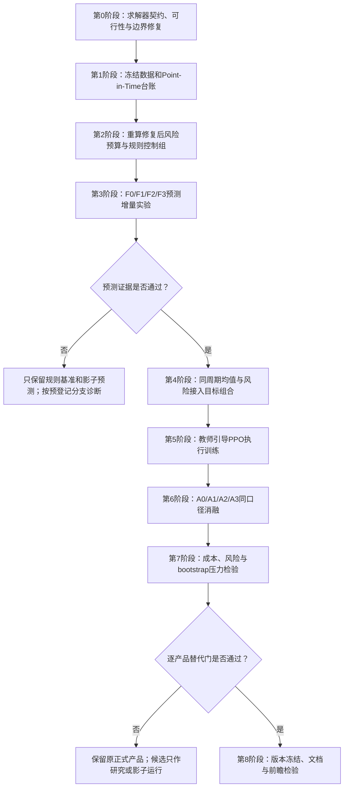

# 固收+ v45 完整执行与改善方案

版本：v45 设计稿，2026-10-14。

状态：**2026-10-15已完成修正后的F0-F3年度训练、108个PPO候选和三产品回测。工程输出检查通过，但预测放行与PPO实际接管均为0，三个研究晋升门均未通过。** 详见 [执行状态](v45_execution_status_20261015.md)、[失败诊断](v45_results_and_failure_diagnosis_20261015.md) 和 [锚点冲突修复](v45_anchor_policy_resolution_20261015.md)。下文保留原设计，实施差异、数据限制和未完成敏感性以上述执行记录为准，不把它当成所有计划事项均已验收。

本文件是预登记设计，不是所有步骤已经成功的声明。v44 的代码、模型与原始报告继续保留，不覆盖其历史结果；当前没有可据此宣布通过正式晋升的v45最终结果。

## 1. 先把策略思路说清楚

这套策略不是让大模型直接决定买什么、买多少。它先建立一个风险预算底仓，让低波、中波、高波承担不同的风险；再用股债九宫格和细分资产状态卡理解市场，生成可解释的相对配置观点；然后让 iTransformer 尝试补充简单规则无法解释的收益信息。受约束优化器把这些观点变成一个目标组合，PPO 最后决定是否执行、执行多少。

因此，各模块有明确职责：

| 模块 | 要回答的问题 | 不承担的职责 |
|---|---|---|
| 风险预算底仓 | 产品允许承担多少、哪类风险 | 不预测所有资产的涨跌 |
| 九宫格与资产卡 | 当期股债及细分资产是什么状态 | 不单独作为随意加仓的理由 |
| 机械 Market Views | 在当期状态下，哪些资产相对占优 | 不把规则分数包装成已校准预期收益 |
| iTransformer | 在简单基准之外，还有没有可重复的相对收益信息 | 不直接输出仓位或绕过风险边界 |
| 观点均值融合与 skfolio | 综合均值、协方差和约束，求出一个目标组合 | 不保证输入观点一定有效 |
| PPO | 对同一个目标，什么时候动、动多少更合适 | 不重选资产、方向或固定持有期 |
| 执行会计 | 按实际成交、报价限制和持仓漂移计算净收益 | 不用目标换手替代实际成交成本 |

v45 的首要任务不是继续增加模型复杂度，而是先修复求解器契约，再分别证明“预测增量”和“执行增量”。1000 epoch 是训练预算上限，不是提升效果的保证，也不能增加独立的市场样本。

## 2. 当前事实与设计边界

### 2.1 已完成的 v44 实验

2026-10-14 的流水线运行时间为 14:23:13 至 15:15:06，约 52 分钟。它复用了冻结的 iTransformer 预测，重新训练了 PPO，不是重新训练了整套预测模型。

保存的 2024-01-02 至 2026-07-15 结果如下，包含 5bp L1 成交换手成本，无风险利率为零：

| 产品 | 年化收益 | 年化波动 | 标准 Sharpe | 最大回撤 | PPO 实际接管日 |
|---|---:|---:|---:|---:|---:|
| low_vol | 6.30% | 2.07% | 2.969 | -1.75% | 231 |
| balanced | 7.82% | 3.06% | 2.477 | -2.52% | 77 |
| high_vol | 13.59% | 7.59% | 1.718 | -6.43% | 377 |

PPO 接管日不等于实际调仓日；接管时也可能选择不交易。

正式组合门为 False。当前低波未超过正式锚点 Sharpe，低波的 Sharpe 分块 bootstrap 门未通过，预测正式开关也存在硬编码研究状态锁死。16 项回归测试、36 项保存输出检查通过，只能说明这些已覆盖项目通过，不能证明所有求解器边界均正确。

2024 年以来已经反复参与研发。上述区间只能称为历史 walk-forward 研究检验，不是未触碰的最终测试集。

### 2.2 本轮必须保留的内容

- 股债九宫格保留，继续作为核心状态描述和风险边界来源，不删除。
- 保留 38 个建模资产：利率 4、信用 6、转债分桶 12、权益 10、另类 6。
- 保留五个控制袖套：rates、credit、convertible_bonds、equity、alternatives。
- 另类继续细分黄金、南华商品、南华有色、南华能化、REITs、美债代理，不用“黄金状态”代替整个另类模块。
- 保留 low_vol、balanced、high_vol，不重新引入额外 growth 产品。
- 保留无现金、无杠杆及产品风险分层；不会为了达到目标波动率而事后加杠杆。
- 38 个输入资产、产品可投池、实际持仓池分别登记。科技成长等当前仅供参考的资产，不因本轮改模型自动开放交易。
- 首轮不接 Agentic，不调用 LLM API、不使用任何对话中的密钥。Agentic 的后续实验须与本轮分开。
- 当前 EP 路径准确命名为“均值观点融合 + skfolio”，不宣称已经实现完整的最小 KL 熵池化。

### 2.3 时间与数据口径

| 用途 | 区间或规则 |
|---|---|
| 本轮原始研究输入 | 冻结至 2018-01-02 至 2026-07-15 |
| 三产品可比历史组合区间 | 2022-01-05 至 2026-07-15，必须按最终共同有效日历复核 |
| 主要研究展示区间 | 2024-01-02 至 2026-07-15 |
| 模型预测起点 | 2022 年，前期可只生成影子预测 |
| 未触碰前瞻样本 | 模型、参数与方案实际冻结后的下一交易日起，不预先假定 2026 年下半年未被使用 |
| 日级执行 | 收盘 t 形成决策，下一交易观察日执行与计价 |
| 成本 | 主口径 L1 实际成交变化乘 0.0005；另做 10bp、20bp 压力测试 |

2018 年开始有研究输入，不代表已经有 2018 年开始的同口径 iTransformer + PPO 样本外净值。若展示 2018 年风险预算净值，应单独标注，不能直接与 2022 年起的完整模型净值比较全区间指标。

第一轮不刷新数据，以免求解器修复、模型改造与样本变化混在一起。后续刷新须建立新的快照和实验编号。

日级 T+1 仍是 close-to-close 记账约定，不是已验证的下一日开盘成交回测。代理资产缺少真实开盘成交信息时，不宣称完成了开盘价、逐笔成交或实际冲击成本验证。

## 3. 总流程与执行顺序



上游失败不自动启动下游长训练。第零阶段不是“调整收益参数”，而是验证系统是否在解它声称的数学问题。

## 4. 第零阶段：求解器修复

### 4.1 已核实的问题

| 编号 | 问题 | 已取得的证据 | 当前 v44 影响范围 |
|---|---|---|---|
| S01 | skfolio 的 max_turnover 是逐袖套上限，SLSQP 使用总 L1 上限 | 设置 10% 时，skfolio 返回约 40% 总 L1；独立总 L1 参考解约为 10% | 约束绑定时两个后端不是同一个问题；原测试未覆盖该情况 |
| S02 | 为保持可行性自动提高换手上限 | 中波 2019-01、2019-04 的月度目标变化约 11.84%、8.31%，配置为 8% | 发生在当前回测开始前，不能据此直接认定 2024+ 净收益错误，但不能宣称全历史严格遵守 8% |
| S03 | 将 previous_weights 先投影到新上下限 | 边界测试内部报告变化接近 0，原始持仓到新目标实际变化为 80% L1 | 优化约束和诊断可能低估变化；执行会计仍须单独按原始实际持仓计成本 |
| S04 | 求解失败直接退回 base，未完整复核 | 测试回退底仓变化 200%，仍超过已经放宽至约 195% 的上限 | 回退本身不保证满足原约束 |
| S05 | 不可行盒约束仍被归一化成权重 | 五个袖套各至少 30%，总下限 150%，却返回各 20% | 应报告不可行，不能用归一化伪造可行解 |
| S06 | 袖套内单资产截断后再次归一化 | 75% 上限的边界例子返回 88.24% | 当前保存的 v44 三产品目标未触发，但代码没有提供严格保证 |
| S07 | mean_rank 归一化消掉整体置信度 | 同方向单条观点置信度 0.01 与 0.99 得到相同的 0.004 均值调整 | 属于观点传导设计问题，应与纯求解器修复分别评价 |
| S08 | 求解后 guardrails 再修改权重，缺少统一复核 | 代码只重新投影上下限，不统一检查原主动偏离和目标变化约束 | 需要新增最终权重契约测试，不能只检查求解前权重 |

协方差已通过 SuppliedCovariance 传入真实 skfolio。正常、非绑定换手案例下，目标函数一致性测试已经通过；这个事实保留，不把全部历史实现描述为虚假调用。

### 4.2 统一数学问题

对五袖套目标权重 w，主目标统一为：

```text
minimize:
    risk_aversion * (w.T @ Sigma @ w)
  - mu.T @ w
  + base_penalty * ||w - risk_budget_anchor||_2^2
  + target_change_penalty * ||w - previous_target||_1

subject to:
    sum(w) = 1
    lower_bounds <= w <= upper_bounds
    ||w - risk_budget_anchor||_1 <= max_active_deviation
    ||w - previous_target||_1 <= max_total_target_change
    已预先声明的九宫格资格限制与风控约束
```

这里的 target_change_penalty 是优化正则，不是实际交易费率。原有 0.45、0.55 等惩罚系数不能解释成 45bp、55bp，也不能与回测 5bp 成本互相替代。

必须拆开三个对象：

| 对象 | 含义 | 是否允许偷偷重写 |
|---|---|---|
| risk_budget_anchor | 当期风险预算底仓 | 如需可行投影，必须保留原值、有效值与投影距离 |
| previous_target | 上一次已生成并通过校验的目标 | 不因新约束先投影后冒称原目标 |
| pretrade_holdings | 实际成交前、经过价格漂移的持仓 | 不得为了降低报告换手而投影或替换 |

月度与日度生成器中的“上一期目标变化”不等于真实成交。现有日度调用把 base 传成 previous_weights 的行为必须整改：生成唯一的、按日期顺序计算的目标路径，显式使用 previous_target；PPO 不参与这个目标路径的计算。

### 4.3 后端与输入契约

- 主后端保留真实 skfolio MeanRisk + CLARABEL。
- 不再依赖 max_turnover 参数实现总 L1；显式加入 `cp.norm1(w - previous_target) <= limit`。
- 以独立 CVXPY  formulation 验证目标与约束；备用后端采用同一凸问题，优先尝试本机已安装的其他适配求解器。未安装的后端不得伪装成可用。
- SLSQP 对含 L1 的非光滑问题不作为默认安全兜底；保留为诊断比较器，任何结果同样必须通过最终约束检查。
- 明确记录实际 solver、backend、依赖版本、退出状态、目标值、协方差哈希和约束残差。
- 拒绝 NaN、inf、缺失袖套名、重复矩阵索引、错误单位、`lo > hi`、总下限大于 1、总上限小于 1、负惩罚等输入。
- 协方差必须按一致标签对齐、对称且正定；不能通过把缺失整列填零并加 jitter 掩盖数据错误。
- 将统一正定修复和 jitter 应用一次，记录修改前后特征值；两个后端使用修复后的同一矩阵。

主输入使用本机已验证的 skfolio 版本作为起点，先锁环境再实施，不顺手升级库。版本登记应同时核对模块实际可导入状态和发行包名，避免 cvxpy-base 安装被误报为 cvxpy 不可用。

### 4.4 可行性、冲突与回退政策

先做可行性检查，再优化收益。使用同一硬约束求出最小所需目标变化，不能继续使用三角不等式估计后直接提高上限。

| 情形 | 必须采取的行为 | 状态 |
|---|---|---|
| 输入数据或盒约束不合法 | 拒绝求解，停止该阶段 | invalid_input |
| 全部硬约束可行，主后端成功 | 检查最终残差，合格才返回权重 | optimal_validated |
| 主后端失败，备用凸后端成功 | 同一目标、同一约束，重新检查 | fallback_validated |
| 全部硬约束不可行 | 输出冲突台账，不生成冒称可行的新目标 | infeasible |
| 上一期目标满足当前所有硬约束 | 经复核后才允许保留该目标 | hold_validated |
| 上一期目标或底仓也不满足约束 | 不允许以 fallback_base 标记成功 | blocked |

默认严格模式不自动放宽目标变化、主动偏离或资产集中度上限。若风控资格变化确实需要强制减仓，必须提前约定独立 risk_override 政策，输出例外原因、所突破上限和实际成本，不能将其并入“所有正常约束通过”。

如果修复后在 2019 年热身或其他日期发现不可行，应先交付约束冲突诊断。不能删除日期、修改历史权重、提高额度或立即开始长训练。平滑锚点或改变约束优先级属于新的行为方案，需要明确确认并重新计算共同控制组。

### 4.5 资产层与最终 guardrails

袖套内资产分配改为真正的有界单纯形问题。对于袖套总权重 W_s：

```text
sum(asset_weights_in_sleeve) = W_s
0 <= asset_weight_i <= 0.75 * W_s
anchor_share_i * W_s - active_limit <= asset_weight_i
asset_weight_i <= anchor_share_i * W_s + active_limit
不符合当时资格的资产不能被新增配置
```

上下限先取交集，再判断可行性。若原底仓 90% 集中在一个资产，同时只允许很小的主动偏离，75% 上限可能无解；正确答案是 infeasible，不是强行返回一个 88.24% 的权重。

九宫格禁增持、趋势刹车和产品上下限尽量作为同一可行域输入，避免求解后又随意截断、归一化。必须保留独立最终验证器，检查目标、风控修改后目标、实际成交权重三个层次。

实际持仓在日末可能因价格漂移越过目标边界；必须记录漂移超限，并在下一可执行决策处理，不能声称事后所有日末持仓都绝对不越界。不可交易资产导致无法纠正时，记录未完成风险处置，不虚构成交。

### 4.6 求解器验收标准

| 检查 | 默认阈值或预期 |
|---|---|
| 预算误差 | 绝对误差不超过 1e-8 |
| 盒约束、主动偏离、总目标变化残差 | 正常目标违约不超过 1e-6 |
| 单资产袖套份额上限 | 不超过 0.75 + 1e-6 |
| 袖套资产权重与目标袖套总额 | 绝对误差不超过 1e-8 |
| 独立凸参考解目标差 | 不超过 `1e-8 + 1e-6 * max(abs(reference_objective), 0.01)` |
| 非唯一或近退化解 | 以目标值与可行性为准，不只比较逐资产权重 |
| 失败、不可行输入 | 必须得到非成功状态，不能返回未经校验的可用权重 |
| 原始上一期持仓 | 在约束和成本计算中未被偷偷修改 |
| 强制故障切换 | 与主后端数学问题完全一致，记录原始异常 |

新增测试至少覆盖：总 L1 换手绑定、逐袖套上限与总量差异、上下限绑定、旧持仓越界、锚点突变、不可行盒约束、失败回退、资产集中度交集不可行、guardrails 后重验、低置信观点、协方差标签错位、缺失输入和近奇异矩阵。

只有完整新增测试和全日期可行性扫描通过，才允许进入基准重算。旧两项正常求解器测试不能替代这些检查。

## 5. 第零阶段附加实验：保留观点置信度

S07 是行为设计改动，不能混在纯数学修复中归因。先生成“仅修复求解器、旧置信度算法”的控制组，再生成“置信度传导修正版”。

机械 mean_rank 仍只表示相对方向，但将方向和强度拆开：

```text
先合并同一card内重复的同方向袖套pair
score[source] += confidence
score[target] -= confidence
direction = centered_score / max(abs(centered_score))
overall_confidence = mean(unique_pair_confidence)
mu_tilt = view_scale * overall_confidence * direction
```

单张卡内相同 source/target 的重复观点默认取最大置信度，避免复制同一证据放大观点；confidence 强制校验为有限的 [0,1] 值。覆盖率、矛盾观点和共享数据来源另行登记，不把它们都伪装成独立证据。

验收例子：单条同方向观点置信度 0.01 与 0.99，应保持方向一致，但调整幅度有区别；两条完全相反、相同强度的观点不能变成强方向信号。

`overall_confidence` 是证据强度，不是已经校准的收益发生概率。该修改的影响必须有独立控制组，不用它来证明 iTransformer 或 Agentic 的贡献。

## 6. 第一阶段：数据与状态台账

### 6.1 数据登记

每个输入字段至少登记：field_id、asset_code、module、source、unit、frequency、observation_date、available_at、revision_policy、proxy_flag、calendar、currency、missing_policy、feature_role、validation_status。

重点核对：

- 30Y 统一使用冻结的固定久期曲线代理，不在财富指数与曲线收益间切换；不是 30Y ETF 成交价格。
- 信用六分桶的产业/城投、评级、久期、财富/价格口径与成员变化说明。
- 转债十二分桶的分桶时点、价格/平价/溢价含义、退市与强赎处理；历史成员不得用当前存量回填。
- 南华商品、有色、能化的指数口径，不能当作无摩擦可交易 ETF。
- REITs 的上市前缺失、分派和收益口径，不能凭代理创造 2018 年真实公募 REITs 历史。
- 美债代理的久期、美元/人民币口径及汇率处理；没有明确汇率处理时不能称为人民币实盘收益。
- 股息、复权、净值与总回报含义；不把未复权收盘价涨跌当成总回报。

未验证真实历史可见日与修订版本的宏观/估值字段不进入严格主模型。它们可留在单独研究分支，不能凭统一 shift(1) 取得 Point-in-Time 认证。

### 6.2 特征处理

| 特征类型 | 首轮处理 |
|---|---|
| 价格行为 | 1/5/20/60/120/252 日收益、均线偏离、回撤和滚动波动 |
| 可验证 OHLCV | 隔夜/日内收益、振幅、收盘位置、成交量与金额变化 |
| 缺少 OHLCV 的债券代理 | 只用可验证曲线、收益和波动，不构造假的成交量或高低价 |
| 行情/成交稳健标准化 | 过去 252 个观察日，至少 126 日，使用滞后的历史中位数与 IQR |
| 慢变量历史分位 | 过去 756 日，至少 252 日；水平与边际变化分别保留 |
| 九宫格 | 原始股债状态、九格 one-hot、状态持续时间与已知转移；不机械标准化分类编码 |
| 固定经济阈值 | 保留原经济单位，例如 bp、价格、溢价率；另附历史分位，不用 z-score 替换原值 |
| 缺失与陈旧程度 | availability mask、距离最后真实观测日的年龄、是否延用估值 |

滚动特征只读取时点 t 以前的窗口，t 的已知行情另作为当前输入。模型所需固定缩放器仅在训练集拟合，不在全历史拟合。

IQR 为零时使用仅历史样本估计的稳健尺度；无足够历史时标记不可用，不借用未来统计量。滚动不足不丢掉整个交易日，也不填造成“真实观测”的零。

### 6.3 缺失与标签

延用估值是会计约定，不是新观测。报价缺失资产不能交易，超过五个允许延用观察日且仍有持仓则阻断回测。未核实缺口原因的延用段不自动视为可用于监督标签的真实行情。

标签使用真实覆盖和已核实休市规则；如果未来标签窗口含无法解释的缺口，则屏蔽该资产/期限标签。特征可用性掩码与标签掩码分开，不能把填补值用于制造额外监督样本。

所有策略共享同一冻结收益、日历、代理和缺口规则。数据筛选改变后，控制组也重算，不能拿更干净的候选去比较不同数据口径的旧结果。

### 6.4 九宫格与资产卡连接检查

对每个状态检查：原始字段 -> 标准化/分位 -> 条件表达式 -> 状态 -> overlay/eligibility -> 相对观点 -> 优化边界 -> 最终目标。

必须覆盖利率、信用、十二类转债、权益细分和六类另类。第一轮不改判定条款，但发现字段不可用时要显示 unknown，不默认为 neutral 或错误触发高置信方向。

信用的利差厚薄、走阔压力、成交压力、资金压力、区域违约压力、尾部风险、CR2 overlay 与状态转移分别登记；共用资金数据的指标不能当作多份独立证据。

## 7. 第二阶段：重算修复后控制组

先固定输入、产品约束、风险矩阵估计和执行会计，再建立以下版本：

| 版本 | 内容 | 作用 |
|---|---|---|
| V44_ARCHIVE | 原 v44 保存结果，原样保留 | 历史参照，不当作新契约控制组 |
| R0_SOLVER_FIXED | 只修求解器契约，保留旧观点算法 | 测量纯修复影响 |
| R1_CONFIDENCE_FIXED | R0 加方向/整体置信度分离 | 测量观点传导改动 |
| A0 | 风险预算底仓和共同交易风控 | 基础风险配置 |
| A1 | A0 加九宫格/资产规则观点与受约束优化 | 完整规则控制组 |

A0 的实际实现应标注为分层风险预算/袖套内配置，不自动写成所有 38 资产严格等风险贡献 ERC。共同法律、可交易性和执行风控应用于所有层。

A0 -> A1 是整套规则与优化增强，不能把差值全部归给单条 Market View 或单个求解器。

重算报告必须先解释变化来自约束修复、报价/会计变化、置信度传导还是预测，不能直接宣布模型收益提升。

## 8. 第三阶段：训练、选模型和放行划分

### 8.1 年度外层

逐年生成 2022、2023、2024、2025、2026 年预测；2026 年只评价至本轮冻结截止。对预测年 Y，截止 C_Y 为 Y 开始前最后一个本地交易观察日。

每个资产/期限的训练标签必须在截止前成熟。统一切分按最长 60 日标签结束时点进行，不用日历天粗略相减。

### 8.2 内层顺序

首先取得按日期排列且最长标签已成熟的可用样本，再从后向前切分：

```text
训练集 T
  -> 60个交易观察日隔离
  -> 126个交易观察日选模型集 V
  -> 60个交易观察日隔离
  -> 126个交易观察日独立放行集 G
  -> 截止日前仅有输入但标签未成熟的观察段
  -> 预测年 Y
```

训练集至少 300 个有效日期；数据不足的年度或组件只输出影子/零增量，不通过缩短隔离或使用未来日期补足样本。

| 对象 | 可读取的样本 |
|---|---|
| 表示预训练、Ridge、均值头、标签尺度 | T |
| epoch、候选模型、学习率等选择 | V |
| 固定候选是否允许上线该年 | G；在候选冻结后只打开一次 |
| 当年已成熟的历史预测可靠性 | 决策当时已经完整成熟的结果 |
| 当年尚未成熟结果 | 不可进入置信度、门控或输入 |

首轮不将 G 回填训练后改变模型。年度模型冻结后，每天用新的已知窗口推理；第一轮不同时试验每月重训，避免再引入一项变量。

旧 v43/v44 编码器只有训练样本、切分、特征和截止契约完全匹配才可作为训练工件复用；不能因为它名称有 causal 就直接用于新的、更早截止训练集。否则重新预训练。

### 8.3 数据量与重叠

38 个资产和多年的日频窗口，不等于 38 倍独立市场周期。120 日窗口、60 日标签、信用/转债分桶相关性会降低有效样本独立性。

损失先在每个日期内平均有效资产/袖套，再在日期间平均，避免资产多的转债袖套机械主导训练。报告有效日期、有效标签、标签重叠、自相关与非重叠检验，不仅报告 cells 总数。

V、G 与历史 walk-forward 结果都参与过既有项目研发，因此这种新切分提高因果和组件选择严谨性，但不能将整个历史重新变成未触碰实验。

## 9. 第三阶段：学习目标

### 9.1 分开两种任务

| 任务 | 问题 | 排序范围 |
|---|---|---|
| 资产任务 | 同一袖套内哪些资产值得相对增配 | 同一袖套、同一日期、同一期限 |
| 袖套任务 | 五大类之间哪些相对占优 | 同一日期的五袖套 |

两类任务分别报告、分别门控，不能用另类资产内部排序通过来批准全部袖套配置。

### 9.2 标签定义

对 t 时点、h 属于 5/20/60：

```text
asset_relative_return(i,t,h)
    = asset_forward_return(i,t,h)
    - own_sleeve_reference_forward_return(s,t,h)

sleeve_relative_return(s,t,h)
    = sleeve_forward_return(s,t,h)
    - common_balanced_risk_budget_reference_forward_return(t,h)

model_increment_target = relative_return - simple_baseline_prediction_B(t,h)
final_mean_view = B(t,h) + learned_increment(t,h)
```

参考组合权重与成员在 t 时点确定，再持有并自然漂移至 h；不能事后选取该窗口最好的基准或用未来权重。所有产品使用同一个预测标签参考，产品差异留给风险预算和约束。

简单基准 B 用当时原始因果特征拟合，包括动量、波动、经过核验的宏观变化及九宫格；不是零向量。零向量无法提供有效横截面 RankIC，不能用“相对零预测”的指标代替对简单方法的增量。

训练集 T 中用于构造增量标签的 B 必须来自扩展窗口的时间顺序 OOF 预测，不能使用在整个 T 上拟合后回填的样本内结果。首轮按季度生成 OOF 块，块开始前只读取已成熟标签，基准至少需要126个有效训练日期；不足的增量标签标为不可用。V、G与预测年则使用仅在T拟合且已冻结的基准。有效增量训练日期不足300时，该候选不进入正式评审。

监督标签为未年化 h 日收益；稳健缩放只用 T 中的标签中位数与 MAD，尺度下限 1e-4，推理后反变换到收益单位。裁剪阈值只在 T 估计，不在全历史 winsorize。

## 10. 第三阶段：四个预登记候选

| 候选 | 编码器 | 增量预测头 | 损失 | 用途 |
|---|---|---|---|---|
| F0 | 不用神经编码器 | 原始因果特征 Ridge | 线性基准 | 检验复杂模型是否有必要 |
| F1 | iTransformer 只在 T 预训练，然后冻结 | Ridge 学习相对 F0 的增量 | 正则线性拟合 | 检验表示学习价值 |
| F2 | 同一预训练起点，只开放最后一层与预测头 | 线性输出头，梯度可回传 | Huber | 检验收益监督是否改善表示 |
| F3 | 与 F2 相同 | 与 F2 相同 | Huber + 0.2 倍 pairwise 排序损失 | 检验排序监督增量 |

F0 只作为控制组。最终 iTransformer 候选选自 F1/F2/F3；若没有可靠胜过 F0，则保留 iTransformer 影子运行，不包装成已取得收益优势。

### 10.1 固定网络与训练参数

| 参数 | 首轮值 |
|---|---|
| 历史窗口 | 120 个交易观察日 |
| 资产数 | 38；局部/宏观/状态特征宽度由冻结 manifest 给出，不继续沿用旧“64变量”口头说法 |
| d_model / heads / layers | 40 / 4 / 2 |
| feedforward | 112 |
| dropout | 0.25 |
| seeds | 17、29、47 |
| 预训练 batch / 学习率 / weight decay | 64 / 2e-4 / 0.01 |
| 监督 batch | 96 |
| 监督预测头学习率 / 编码器学习率 | 2e-4 / 1e-5 |
| 监督 weight decay / gradient clip | 0.04 / 1.0 |
| 监督头独立训练 | 前 20 epoch 冻结编码器，此后最多开放最后一层 |
| 预训练/监督最大 epoch | 分别 1000，不强迫训练满 |
| 最早允许停止 | 预训练 100 epoch；监督 50 epoch |
| 评估频率 / 无改善耐心 | 每 5 epoch；连续 40 epoch 未有实质改善，等价于 8 次评估 |
| 预训练最小实质改善 | 相对验证损失改善 0.3%，使用明确 relative_min_delta 字段 |
| 监督最小实质改善 | 下述选择分数提高至少 1e-4 |
| 调度 | 8 epoch warmup，之后 cosine，最低学习率为初始值的 5% |
| 期限任务权重 | 5/20/60 日分别 0.15/0.50/0.35 |
| Ridge 初始正则 | 沿用 alpha_per_training_cell=0.30，并登记实际样本权重和等效 alpha，不追加隐含大网格 |

输入包括局部特征路径、宏观/状态路径与可得性掩码；九宫格 one-hot 与连续股债分数同时保留。缺失值是否填到网络张量中必须伴随 mask，不能把“占位零”解释为观测为零。

预训练继续使用历史掩码重构，不读取前瞻收益。F2/F3 的训练改变只发生在 T，不把 G 的重构或收益拿来训练编码器。

minimum_epochs 只限制何时停止，不限制最佳检查点来自哪个 epoch；记录 trained_epochs 与 selected_epoch 两个值。即使训练 1000 轮，部署仍用通过评估的检查点。

### 10.2 损失与选模型分数

Huber 的 beta=1.0，计算在训练期稳健缩放标签上。排序损失为同日期同组有效成对标签的 logistic loss；资产只在袖套内配对，袖套在五类之间配对。对每组先平均，避免组合数量影响权重。

```text
L_F2 = sum_h horizon_weight_h * (asset_Huber_h + sleeve_Huber_h)
L_F3 = L_F2 + 0.2 * sum_h horizon_weight_h * (asset_pairwise_h + sleeve_pairwise_h)

selection_score
    = 0.5 * weighted_asset_delta_RankIC
    + 0.5 * weighted_sleeve_delta_RankIC
    - 0.1 * std(block_delta_RankIC)
```

V 内使用预先固定的 20 日诊断块估计稳定性，成分不足时记 unavailable；缺少可用袖套任务时不临时重新分配 0.5 权重以提高分数。候选之间分数差不超过 0.005，优先选更简单的候选。

0.005、0.01 等阈值是预登记设计值，不是已验证的金融常数，不从最终收益反推选择。

## 11. 预测放行与正式状态

### 11.1 拆开状态，解除流程锁死

当前预测脚本将 enabled_for_formal_strategy 硬写为 False，而组合晋升又依赖该字段。v45 不改成硬写 True，而是拆开：

| 状态 | 含义 |
|---|---|
| representation_contract_pass | 时间、特征、标签、编码器训练边界及种子完整性通过 |
| predictive_evidence_pass | 至少一个可消费组件通过质量门与新增增量检验 |
| portfolio_stage_allowed | 合规且存在可消费组件，允许组合实验 |
| profile_promotion_pass | 指定产品的会计、绩效、稳健性和执行证据通过 |
| enabled_as_formal | 需要的三个产品均通过，且没有未披露的硬约束失败 |

预测状态不再等待组合正式状态，组合评审也不拿收益反向证明预测质量。不可消费组件可以记录影子结果，但对正式目标的学习增量为零。

### 11.2 组件质量门

首轮保留 v44 的预年验证、完整种子和两年已成熟历史预测证据要求，不因放行率低直接降低阈值：

- 资产/袖套预年最低 RankIC 仍为 0.10/0.12；原配置中初始直接放行关闭的行为不自动解除。
- 先前成熟 OOS 至少两年；资产/袖套最低历史 RankIC 仍为 0.04/0.05。
- 原种子一致性、正向验证块比例等既有质量条件继续登记。
- 新增对 F0 的配对平均增量 RankIC 至少 0.01，三种子至少两种子增量为正。
- 对增量采用 60 日分块 3000 次重采样，要求单侧 90% 下界大于零；对多组件检验登记完整比较数量，并进行预先约定的 BH 10% FDR 辅助审查。

旧门与新增条件是并列要求。增量门使用“B + 增量”相对 B 的预测效果；影子原始预测与放行后预测都要报告，不用满表零增量拉低/抬高平均指标。

G 样本不足、RankIC 不定义、参考预测不可用或标签覆盖不足，均不是通过。2022/2023 年可能只能积累影子预测，不能把 2024 年才获得的两年证据倒写回 2022 年。

以上是较严格的起点。若没有组件通过，正常结论就是“本轮未证明增量”，不是降低门槛直到开启。

## 12. 第四阶段：观点进入优化器

### 12.1 输出接口

每条输出至少包含 as_of、asset/module、horizon、baseline_mean、learned_increment、final_mean、seed_disagreement、active_component、gate_reason、available_coverage、model_signature。

输出保留 h 日收益单位，不先做最大绝对值归一化后冒称收益。RankIC 可以使用排序，但优化器输入是明确单位的均值。

### 12.2 周期转换

```text
mu_21 = 21 * sum_h (horizon_weight_h * mu_h / h)
Sigma_21 = 21 * Sigma_daily
```

该转换是近似周期换算，不是精确复利预测；21 倍协方差缩放隐含对序列相关的简化。另用训练期非重叠 21 日收益协方差做敏感性分析，记录差异。

默认日频风险矩阵使用过去 252 日、至少 60 日，sample_shrink 向对角收缩 20%。月度锚点维持原有效配置的月频窗口。预测只进入均值，不将同一观点重复写入协方差。

原 daily_mu_scale 字段对应旧人为分数映射。R0/R1 保留它作为历史控制；新统计预测接口不再次用该字段把已校准收益任意放大。

### 12.3 首轮约束与传导诊断

| 项目 | low_vol | balanced | high_vol |
|---|---:|---:|---:|
| 月度目标 L1 主动偏离上限 | 0.015 | 0.022 | 0.036 |
| 月度总目标变化上限 | 0.06 | 0.08 | 0.11 |
| 日度目标 L1 主动偏离上限 | 0.012 | 0.022 | 0.036 |
| 日度总目标变化上限 | 0.04 | 0.08 | 0.11 |
| 单资产相对袖套锚点的资本权重偏离 | 0.004 | 0.010 | 0.020 |
| 单资产占袖套上限 | 0.75 | 0.75 | 0.75 |

表中是目标约束，不自动等于真实成交换手上限。第一轮不新增一个此前并不存在的成交硬上限，然后把效果混称为 PPO 提升。真实成交流量始终按漂移持仓计算、计成本和披露；若后续增设成交上限，要在 A1/A2/A3 同时应用并作为独立行为实验。

诊断必须记录：原始均值、有效均值、风险预算锚点、约束前候选、最终目标、目标变化、实际成交、报价冻结、各项约束裕度及惩罚贡献。

“模型有预测但权重没变”需要定位到信号尺度、目标函数、可投池、约束还是 PPO 执行，不直接归因于模型无用。

## 13. 第五阶段：PPO 执行增量

### 13.1 不再与不同目标比较

PPO 版本 P 与机械版本 M 使用完全相同的日目标、起点、报价限制、资产池、成本和权重漂移。M 使用预登记机械执行规则，只改变谁决定执行比例。

首轮奖励唯一主要改动是将比较对象从月度正式锚点替换为 M：

```text
reward = 100 * (
    net_return_P - net_return_M
    - 原有相对下行惩罚
    - 原有相对波动惩罚
    - 原有相对回撤惩罚
    - 原有风险预算主动偏离惩罚
)
```

首轮其他惩罚系数先保持现有值，避免奖励对象、网络和风险偏好同时变化。各项惩罚要独立输出，随后才能判断是否发生惩罚主导或“永不交易”塌缩。

### 13.2 状态与动作

- 状态保留九宫格、资产卡摘要、模型均值与分歧、当前/目标/锚点袖套权重、目标距离、实际持仓波动、回撤、距上次真实成交日的时间以及报价/流动性摘要。
- 不把未来实现收益、未成熟 IC、教师动作或未来执行报价放入状态。
- 动作为 0、0.25、0.50、1.00，表示向目标推进比例。
- 每个交易观察日均可决策，持有时间由逐日不交易自然形成。
- 5/20/60 日是预测任务与标签跨度，不是必须等满的调仓周期。
- 首轮保留已有最低持有保护，低/中/高为 3/2/1 日及原流动性例外；因此不能宣传为毫无规则限制的自由控制器。

### 13.3 教师与训练历史

教师仍使用完全成熟的 5 日成本感知窗口，比较 P 候选与同目标机械执行 M。历史标签允许使用训练期已经实现的未来收益作为监督结果，但整段窗口必须处于允许训练范围内，决策状态绝不读取该结果。

PPO 训练目标来自按当时信息生成的年度 OOF 预测，不把当年或最终模型回填到更早历史。模型目标本身的可见时间、门控状态也要随训练日期保存。

每个产品/评估年训练历史至少 252 个有效执行日期；选模型与独立放行各占历史的 10%，间隔使用至少 20 日且大于教师标签跨度的隔离。不足则该年保持机械执行，不借用本年结果。

### 13.4 预登记小网格

| 参数 | 值 |
|---|---|
| hidden_dim | 32 |
| seeds | 17、29、47 |
| max_epochs / updates_per_epoch | 120 / 4 |
| learning_rate | 1e-4、3e-4 |
| entropy_weight | 0.004、0.01 |
| gamma / GAE lambda / clip | 0.995 / 0.95 / 0.15 |
| value_loss_weight | 0.5 |
| 教师预训练 / 初始指导权重 | 30 epoch / 0.15 |
| 早停 | 沿用已明确实现的验证无改善规则，不用本年净值挑 epoch |
| CPU torch_threads | PPO 初始为 1，模型阶段另做吞吐测量 |

最多四个 PPO 参数组合；若覆盖 3 产品、3 种子、2024/2025/2026 三折，最多 108 次拟合。选择只读对应选模型段，独立放行段在组合冻结后评估。

保留至少两种子通过、至少三个放行块、正向块比例至少 2/3、最差块限制等现有执行门要求。minimum_validation_edge=0.0003 为现有奖励标度中的阈值，不将其误称为 3bp 收益；同时输出真实成本后收益差。

## 14. 第六阶段：四层同口径消融

| 层次 | 策略内容 | 主要比较 | 固定项目 |
|---|---|---|---|
| A0 | 风险预算底仓 + 共同硬风控 | 基础配置能力 | 数据、资产池、会计 |
| A1 | A0 + 九宫格/资产规则观点 + 约束优化 | 整套规则增强 | 非模型目标规则 |
| A2 | A1 + 已放行 iTransformer 增量，机械执行 | A2-A1：预测增量 | 机械执行规则 |
| A3 | 与 A2 完全相同目标，PPO 决定执行 | A3-A2：执行增量 | 目标序列、报价、成本 |

A2/A3 的目标文件必须具有同一内容哈希。两个执行器独立维护自己的漂移持仓，不能通过共享同一实际持仓状态使收益错误一致。

若没有预测组件放行，应明确 A2 退化为 A1，不强行称为模型已参与；PPO 未放行的日期标注机械回退原因。

完整比较包含全年和 2024+ 子区间；所有增量必须在同日样本上计算，不用候选最好的日期集合替代完整共同样本。

必须单独汇报 R0/R1，否则不能区分求解器修复、置信度设计、预测与执行贡献。

## 15. 第七阶段：正式门与产品定位

### 15.1 三种“通过”不混用

1. 工程通过：输出有限、权重有效、报价/执行/成本/可行性正确。
2. 历史研究通过：同口径历史增量与稳健性达到预登记要求。
3. 前瞻确认：冻结后未参与调参的预测与执行持续验证。

工程通过不等于有超额；历史研究通过不等于已经保证未来有效。历史结果可以支持候选晋升研究配置，但不能据此宣称实盘与过拟合问题全部解决。

### 15.2 逐产品门

每个产品的 A3 相对修复后的 A1，在同一 2024+ 区间检查：

- 复合年化收益差不小于 0。
- 标准 Sharpe 差不小于 0。
- 无未披露的硬约束违规、成本漏计、时点逆序或缺口持仓错误。
- 3000 次、20 日分块 bootstrap：年化收益差为正比例至少 0.80，Sharpe 差为正比例至少 0.60。
- 使用同样的 60 日块长度报告敏感性；若证据方向翻转，暂停正式晋升，不能只展示 20 日块。
- 预测与执行组件各自具有独立的前期放行证据，不能只用组合 Sharpe 为两者背书。

上述门不用于外层年份选模型。分块重采样比例不是未来获胜概率，必须同时展示差值区间。旧 v6 的比较只作附加历史参照，不自动具有相同数据和会计口径。

低波失败只阻断低波替代；中/高波单独评审。整套“三产品正式晋升”仍要求三个产品全部满足各自条件。

### 15.3 产品特色

| 产品 | 首要研究目标 | 不接受的改善 |
|---|---|---|
| low_vol | 稳定、浅回撤、低成本，在此基础上增厚 | 为多一点收益显著增加权益/转债尾部暴露 |
| balanced | 相对基准的稳健 Sharpe 与适度增厚 | 单一代理或单个年份解释全部超额 |
| high_vol | 风险约束内更高的绝对收益，同时保持合理 Sharpe | 只降低波动而长期牺牲收益，却包装成绝对收益增强 |

目标和验证期检查预测波动、风险贡献排序。low < balanced < high 应有可解释的结构差异，不能靠最终净值事后缩放。

风险越高不保证每个年份收益越高。不能为了年度收益排序强行改变事前预算。波动率、回撤和持仓特征都需要独立展示。

## 16. 成本、样本与风险压力检验

| 检验 | 实施方式 | 作用 |
|---|---|---|
| 成本压力 | 5/10/20bp，重新计算净值与奖励比较结果 | 看模型收益是否被真实换手吃掉 |
| 执行敏感性 | T+1 主口径，再观察额外延迟一日 | 检查信号是否只靠极短时点收益 |
| Bootstrap | 20/60 日块，3000 次，固定种子 | 覆盖序列相关与标签重叠敏感性 |
| 年份与九宫格 | 逐年、逐状态报告共同样本表现与样本数 | 查单一年份或单一状态依赖 |
| 代理依赖 | 分解 30Y、黄金、信用、转债分桶收益贡献；另做明确的禁用敏感性实验 | 不把特定代理的异常收益当成模型优势 |
| 数据缺口 | 延用段收益、权重、交易与缺口原因台账 | 查人工平滑对波动/Sharpe的影响 |
| 共同风险 | 股债/金债相关性、久期与信用共振、流动性压力 | 查分散化是否在压力期失效 |

10/20bp 是统一费率压力，不是真实市场冲击成本估计。不同资产流动性费率、实际成交容量与开盘执行验证另设后续实盘研究，不在本轮冒称完成。

风险经验卡 K1333、K1281 用来设计检查问题，不将 2026 年报告或经验库内容回写成早期历史可见特征，也不因历史经验默认黄金或美债必然避险。

## 17. 不及预期时的有限改善分支

### 17.1 触发时点

下表的模型调整只允许由 T/V 诊断触发，并在打开 G 前完成。G 或外层历史结果不理想时，只能拒绝晋升、保留基准或重新登记新的研究实验；不能把同一 G 再当未触碰验证集反复调参。

首轮之后最多两轮定向改善，每轮最多两个新增预测/策略候选。所有尝试进入实验登记，包含失败和无改善版本。

### 17.2 明确的分支

| 问题 | 诊断 | 允许的下一步 | 禁止的做法 |
|---|---|---|---|
| 求解器失败/不可行 | 精确约束冲突、矩阵、原始引用权重 | 修输入或提交显式约束政策；重跑共同控制组 | 自动增加额度、删日期、跳过约束 |
| 训练 loss 降、V 变差 | 重构/Huber/排序与验证分开，检查实体记忆 | 两候选：1层24维、4头FF64；原结构dropout0.35 | 强迫采用末轮1000epoch |
| 模型不如 F0 | 检查相对标签、成熟日期、资产/袖套任务差异 | 两候选：仅20日任务；只做袖套内资产增量 | 让PPO替代预测证明 |
| 有 IC、无权重变化 | 看收益尺度、目标函数项、活跃约束 | 在V中单独检验幅度1.0/1.5，仍须合法且重建A2/A3共同目标 | 按2024+收益放宽边界 |
| 毛收益好、净收益差 | 分解真实换手、价差代理、收益持续期 | 新增成本感知无交易区；所有相关对照使用同一执行契约 | 删成本、用目标换手算实际成本 |
| PPO塌缩为永不动/总是动 | 动作占比、奖励项贡献、教师类分布 | 单独比较教师权重0和0.15；另一轮才修改主动偏离惩罚 | 同时改奖励、网络和上限找好看净值 |
| PPO种子不稳定 | 各种子G奖励和非重叠块一致性 | 降策略容量/增强正则，保留多种子要求 | 只汇报最好种子 |
| 低波不及A1 | 比较风险增量与微小收益是否覆盖费用 | 低波保留A1，模型/PPO仅影子；中高波独立审查 | 用高波改善证明低波成功 |
| 产品特征接近 | 看风险贡献、上下限、约束贴边和有效可投池 | 在V上校准产品预算，每次只改一个预算维度，另列预算实验 | 对最终样本后验加杠杆或缩放 |
| 收益来自单一代理 | 检查真实数据源、代理方法与分项贡献 | 剥离代理做敏感性；无可靠替代时保留明确研究限制 | 修饰代理或删除不利区间 |

有限改善预算耗尽仍不达标，输出“本轮未证明可部署增量”及失败原因。iTransformer 与 PPO 的代码和影子工件保留，但正式产品不得为了技术名词强行调用失败模型。

## 18. 安全、监控与断点

- 实施前登记 data/config/code/model 哈希和实验编号；每轮输出目录隔离。
- 第零阶段的任何硬错误阻断长训练；协方差错位、权重不归一、非法边界、缺报价成交、成本错误立即停止。
- loss/梯度出现 NaN 或 inf 停止该种子，保存上下文，不通过自动重试隐藏失败。
- 持续训练/验证分化触发既定早停，保留最佳检查点；不是无限增加 epoch。
- 保存每 epoch 的训练损失、每5 epoch的验证、候选选择、放行判断及实际执行原因。
- 进度同时包含阶段、产品、年份、种子、epoch、已用时间、最近进展与估计剩余时间，不能只显示一个无含义的百分比。
- 断点复用检查数据、代码、切分与目标签名；修改会计/奖励/求解器后拒绝直接加载旧 PPO。
- 若无心跳且无epoch进展，检查所属进程；只处理本轮明确登记的 PID，不笼统结束所有 Python 进程。
- 本轮训练使用本地冻结数据，不需要访问行情或 LLM 网络；不执行数据刷新或秘密凭证写入。

v44 的52分钟只代表其PPO重训。v45含编码器训练、候选比较和最多108次PPO拟合，不能承诺仍在52分钟完成。实施后先用首批epoch实测吞吐，再提供带上下界的总耗时估计；PPO是否双worker要先比较吞吐，不盲目提高并发。

## 19. 待实现文件与阶段交付

以下主要是计划接口；2026-10-15已创建的第零阶段文件以执行状态文档为准，其余项不代表已创建、可运行或已有结果：

| 阶段 | 拟定交付 |
|---|---|
| 0 | 已创建 `scripts/test_v45_solver_contract.py`、`output/reports/v45_solver_audit.csv` 和阶段门；日频全策略接入待完成 |
| 1 | `output/reports/v45_data_dictionary.csv`、`v45_feature_manifest.json`、数据快照与可得时点审计 |
| 2 | R0/R1/A0/A1同口径净值、权重、收益与修复影响表 |
| 3 | 年度T/V/G日期表、F0-F3预测、loss曲线、RankIC增量、种子一致性与组件门 |
| 4 | 均值/协方差单位表、共同目标、约束裕度与观点到权重传导表 |
| 5 | PPO模型、训练日志、教师审计、动作分布及执行放行原因 |
| 6-7 | `v45_ablation_summary.csv`、三产品净值/回撤/持仓/归因、成本与bootstrap报告 |
| 8 | `v45_research_workbook.xlsx`、`v45_research_report.html`、最终方法与复现MD、实验登记 |
| 入口 | 已创建 `scripts/run_v45_research_pipeline.py`，当前仅支持第零阶段；完整v45训练配置待实现 |

Excel拟定工作表：执行摘要、数据清单、输入输出、样本划分、修复影响、四层消融、预测增量、PPO增量、权重与风险、成本压力、Bootstrap、失败实验。

图表须包括同起点归一化净值、回撤、五袖套持仓、38资产分项或可筛选持仓、收益归因、训练/验证曲线与动作间隔分布。不能仅显示Top14加“其他”就声称全部资产已解释。

未来入口应支持 `--stage solver/data/baselines/forecast/targets/ppo/evaluate/all` 和签名校验后的 `--resume`。这些是实施后的接口要求，不在当前文档发布可误认为已可运行的新命令。

## 20. 实施检查清单

### 已完成的设计与证据

- [x] 核对v44三产品保存结果、正式门和bootstrap。
- [x] 只读核对实际求解器代码、skfolio定义和协方差接入。
- [x] 复现总L1、自动放宽、原持仓投影、异常回退、不可行盒约束及置信度边界问题。
- [x] 核对保存v44目标没有触发75%单资产袖套份额违规。
- [x] 整理本方案；标明设计值、历史事实与研究限制。

### 等待命令后才实施

- [x] 新增隔离第零阶段核心求解器与边界测试；尚未完成全策略接入。
- [ ] 全日期可行性扫描和冲突审查通过。
- [ ] 数据与状态可见时间台账完成，严格主分支字段冻结。
- [ ] R0/R1/A0/A1控制组重算。
- [ ] T/V/G切分与四预测候选实现、训练和评审。
- [ ] 统一周期目标接口和最终约束检查。
- [ ] 同目标机械执行基准与PPO增量训练。
- [ ] 四层消融、压力检验和逐产品门。
- [ ] Excel/图表/方法说明及模型版本冻结。
- [ ] 前瞻检验开始，并明确保持参数不因新表现随意调整。

用户只授权“执行第零阶段”时，不启动模型训练；授权“按本方案全流程执行”时，也必须逐阶段通过门，失败停在对应阶段，不自动放宽条件。

## 21. 现有证据入口

项目根为 `C:/Users/lenovo/Desktop/fixed_income_plus_allocation`，以下为项目相对路径：

- `src/ep_skfolio_optimizer.py`：均值融合、外部协方差及求解后端。
- `src/integrated_daily_view_ppo.py`：日目标、21日风险尺度与guardrails。
- `src/hierarchical_asset_portfolio_v7.py`：资产分配、教师PPO、执行及正式门。
- `scripts/163_train_causal_linear_probe_itransformer.py`：冻结表示、Ridge及硬编码预测正式状态。
- `scripts/176_test_accounting_repairs.py`：现有行为测试，不包含全部新增绑定约束案例。
- `scripts/178_validate_v44_repaired_outputs.py`：已保存输出36项检查。
- `output/reports/hierarchical_asset_itransformer_v44_accounting_fixed_three_profile_summary.csv`：原v44指标。
- `output/reports/hierarchical_asset_itransformer_v44_accounting_fixed_portfolio_gate.json`：原v44正式门。
- `output/reports/v44_balanced_optimizer_diagnostics.csv`：2019年换手上限例外证据。

## 22. 研究与方法参考

- [skfolio MeanRisk官方说明](https://skfolio.org/generated/skfolio.optimization.MeanRisk.html)：尤其核对逐资产max_turnover与显式自定义约束；具体实施以锁定的本机版本为准。
- [iTransformer原论文](https://arxiv.org/abs/2310.06625)：多变量时间序列表示与预测，不提供金融超额收益保证。
- [PPO原论文](https://arxiv.org/abs/1707.06347)：策略优化方法，不保证特定市场上的收益提升。
- [Deep Reinforcement Learning that Matters](https://arxiv.org/abs/1709.06560)：随机种子、实验条件与可靠评估的重要性。
- [The Probability of Backtest Overfitting](https://www.davidhbailey.com/dhbpapers/backtest-prob.pdf)：重复策略筛选的选择偏差风险；本方案的实验登记与有限搜索不能被描述为已经消除全部过拟合。

最终要求是：先证明系统解对问题，再证明预测与执行分别有增量，最后检验这些增量是否稳健。没有证据时保留基准，不能靠修改开关或包装结果完成目标。
