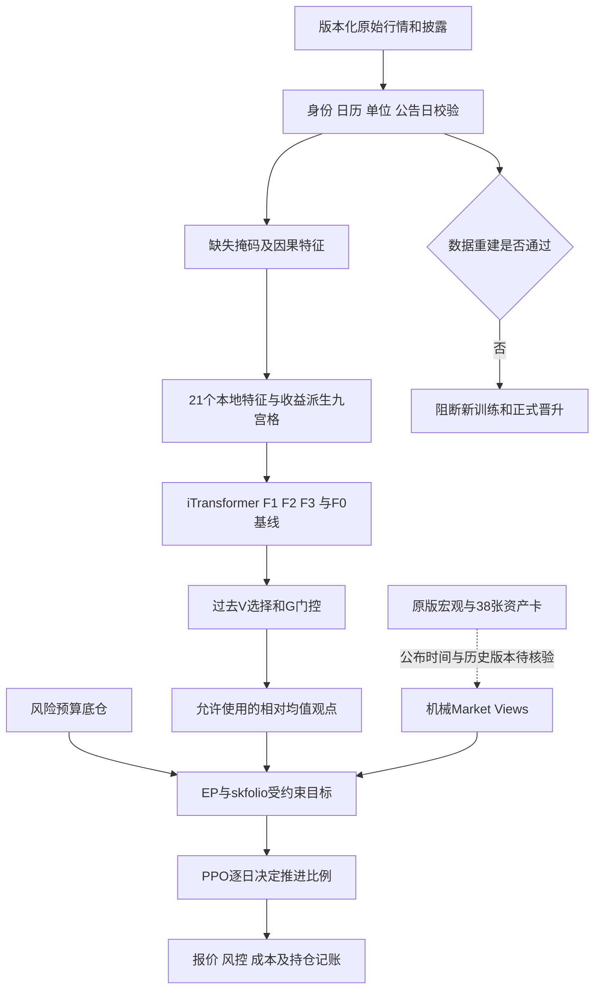

# V49 项目完整性审查与修复记录

> 最新后续：V50 已实际完成 2017 年以来的全候选转股余额公告补查及公募发行方式核查，原先“早期披露不足”的结论已更新。公告口径 12 桶收益覆盖达到 99.83%，但不等于交易账本、总回报或模型正式门通过。详见 [V50 数据修复](v50_cb_multivendor_data_repair_20261015.md)。

> 本日后续更新：已接入截至 2026-10-14 的最新本地转债数据库，完成独立全历史候选重建、11 只定向券排除、410 个实际行情字段补数及事前退出限制。历史余额诊断版缺失桶日从 1,065 降至 46；公告历史及剩余现金流仍未完整验证，正式训练门不放行。详见 [转债数据库修复记录](v49_latest_cb_database_update_20261015.md)。下文“历史重建未完成”指正式可用性验证，不表示没有运行候选重建。

## 先给结论

当前项目不能宣称已经排除严重问题，也不宜直接继续重训以追求更高夏普。本轮确认了转债收益构造中的事后成分筛选风险、单券上限失真，以及神经编码器对全缺失资产的隔离不足。已实施独立的新分支修复和测试，但历史数据重建及完整重训尚未完成。

旧结果保留供复核，不再将工程测试通过等同于全数据无未来信息、实盘可交易或模型有效。此次没有新增策略年化收益或夏普结论。

## 1. 高优先级发现

| 级别 | 问题 | 证据和影响 | 当前处理 |
|---|---|---|---|
| P1 | 转债桶按当日收益是否存在筛选成分 | `scripts/116_refresh_latest_data.py` 的 `active` 包含 `r.notna()`，随后重新分组、归一。指数收益所对应的持仓并非完全在前一日确定 | 新函数不接受未来收益参数；下一日缺持仓收益则桶收益缺失，不事后换成分 |
| P1 | 原 10% 单券上限在归一后可能失效 | 截断金额后再除以截断金额之和，不保证最终权重 <=10%；8 只成员与 10% 上限也不可同时满足 | 采用带上限的迭代分配，至少 10 只；不足则按事前规则扩大组别，仍不足则不给伪指数 |
| P1 | 缺失资产身份影响其他资产和袖套表示 | 原注意力未屏蔽整段无观察资产，袖套均值也包含其嵌入 | V49 对全缺失资产屏蔽 key/value，局部特征池化使用有效掩码，袖套只平均有效资产 |
| P1 | “完整投研输入”与当前严格模型输入不一致 | V45 元数据只有 21 个本地行情特征及 11 个收益派生九宫格变量，未输入完整原版宏观和资产卡 | 明确披露，不将原版状态卡或 Agentic 功能算作已进入当前严格模型 |
| P1 | 历史神经训练窗口明显陈旧 | 2026 模型 T 信号截止 2024-03-22，标签截止 2024-06-24；2025 更多用于选择和门控 | 保留隔离、不偷缩 purge；需预先设计更贴近择时任务的分期限滚动协议，不能仅增加 epoch |
| P1 | 代理收益/数据公布时间仍未完整验证 | 信用评级及产业/城投标签、REIT 分红、美债汇率、转债终止现金流均影响可解释性与可交易收益 | 新训练入口在数据重建未批准时阻断，不用旧收益与新定义直接拼接 |
| P2 | 成本覆盖不完整 | 组合层 5bp 不自动包含转债桶内部每日成分重构成本，商品指数也非现货 ETF | 单列待解决，不将组合层费用称作全部交易成本 |
| P2 | 年度/分组标签的有效信息少于表面样本数 | 120 日输入和 5/20/60 日标签高度重叠；多个转债桶会因回退共享成分 | 按日期/分块评价，不将 38 资产乘日期视为独立样本，不用 bootstrap 正概率当未来胜率 |

冻结 V45 转债收益与当前旧数据源逐资产对齐，最大差异约 `3.73e-9`。这说明旧构造与现有数据相关，不是一个可以忽略的无用脚本问题。但本轮尚未完成全历史正确重建，不能据此断言旧夏普究竟高估或低估了多少。

## 2. iTransformer 具体是什么

实际配置：120 个交易日窗口，38 个上下文资产，每资产 21 个特征；九宫格 9 个 one-hot 加股债两个连续坐标，共 11 个全局变量；缺失掩码另行输入。模型宽度 40，跨资产注意力 2 层、4 头、前馈宽度 112，dropout 0.25。总参数约 261,644，包含自监督重构头及未直接用于当前预测输出的历史核心头。

当前代码是**层级倒置历史编码变体**，不是直接调用官方 iTransformer 包，也不是逐行照搬官方模型。每个变量的 120 日历史先投影为 token，再在资产内池化；原默认 `local_num_layers=0`，因此资产内没有额外 Transformer 层，跨资产层才做注意力。这个设计有计算上的理由，但需准确命名，不能声称做了原论文完全相同的架构实验。[官方实现](https://github.com/thuml/iTransformer)将独立序列作为变量 token 来学习变量间关系。

模型任务为 5/20/60 日相对收益，不是直接预测每天仓位：

- F0：原始因果特征的 Ridge 基线。
- F1：真实自监督预训练的编码器，加冻结表示上的 Ridge 读出。
- F2：自监督初始化后，预测头与最后编码层监督微调。
- F3：在 F2 类目标上增加成对排序损失。

因此不能把 F1 的读出称为监督训练了 1000 epoch 的端到端网络，也不能把 F0 回退的组合表现归功于神经预测。

当前严格预测分支和拟接入完整框架的边界如下。虚线部分不是已经通过的输入合同：



检查到 2026 年 seed17 自监督阶段实际训练 220 epoch，选中第 180 epoch；不是只训练 2–5 次。所有年份/种子/阶段的实际训练记录保存在 `output/reports/v49_project_review/actual_training_epochs.csv`。

### 新缺失隔离实现

`src/v49_masked_forecast.py` 保留原结构和参数形状，增加有效输入校验、局部特征池化掩码、跨资产 key/value 屏蔽、按有效成员的袖套池化及安全窗口边界。全缺失组返回有限的零表示，不产生 softmax 全负无穷导致的 NaN。

用真实 2026 自监督 checkpoint 做反事实测试：将一个资产的整段观察掩码置空，再仅改变该资产身份嵌入。原编码器其他资产/袖套隐藏表示会变化，新编码器变化为零。这个测试证明隔离属性，不是收益改善证据，也不是说明原模型直接偷看未来收益。

同权重、全部观察完整时，新旧模型输出一致；新增掩码行为改变后仍需重新训练及独立评价。旧 checkpoint 仅用于诊断，不冒充在新结构下已训练完成的模型。

新训练实现以受控上下文接入原 F0–F3 训练器，退出后恢复旧全局对象。新版本签名加入新代码哈希、保存到单独 V49 路径。该入口强制单个 seed worker，防止 Python 子进程重新导入旧类而静默训练错误架构。多种子仍保留，不代表只训练一个种子。

## 3. 当前新数据处理

截止日固定为 2026-10-14，原 7 月冻结集不覆盖。

- 已取得 24 条原有资产序列并通过身份与重叠价格检查，另有 9 只 REIT 成分、3 条辅助指数。
- 转债日行情：70 个交易日、21,982 条记录、350 个代码。
- 新增 5,243 条带公告日期的转股及余额披露，覆盖 304 个代码；另有 457 条赎回信息、64 条发行记录。原始发行数据包含晚于截止日的结果公告字段，不能只看发行预告日就把最终发行结果回填历史。
- 公告时间处理：统计截止日不等于可见日。余额在公告后的下一交易日开始可用，以最后已公开余额计权，并记录公告年龄，不把它称为每日真实余额。超过 120 个自然日则停止使用，绝不回填到公告前。[Tushare 转股结果字段说明](https://tushare.pro/document/2?doc_id=247)区分公告日期与统计截止日期。
- 12 个新转债桶已形成 828 条候选桶日记录，权重和为 1、单券最大权重为 10%；100 条因必要持仓缺收益而保留缺失，涉及 36 个代码、28 个交易日。待处理停牌/停止交易及终止现金流，不能事后删除这些持仓。
- 9 只 REIT 已取得独立未复权行情并对分红去重。分红按已实施、公告不晚于除息日的事件计入每份现金，形成 69 个完整候选收益日。采用除息日即刻再投资的研究总收益代理，不等同实际现金派发日可再投资；不在前复权价格上再次加现金。[基金分红字段说明](https://tushare.pro/document/2?doc_id=120)明确 `div_cash` 为每股派息元。
- CPI/PPI/PMI 已精确筛回国家统计局来源，DR007/R007 筛回中国货币网原始利率；误匹配的 IMF、移动平均、向前复制序列不进入候选。实际公布时间与历史版本未确认，所以未放入训练特征。
- 已补到中债国债 10Y/30Y 及中短期票据 AAA 3Y 原始收益率，国内股票交易日上无缺口；不能用 10Y 以上财富指数替代原模型的 30Y 固定久期曲线 token。

候选位于 `data_processed/v49_review_candidates/`。其名称明确带 candidate 或 pending，不是已经批准的完整 38 资产训练集。

## 4. 当前没有解决的事项

1. 全历史转债成分、披露余额、退市/强赎/转股和终止现金流重建。7–10 月修复不能洗净 2018 年以来的旧收益。
2. REIT 全历史一致总收益口径、再投资及内部换手成本。
3. 美债原币/人民币、汇率、海外收盘对国内当日可见性的合同。
4. 宏观和原版资产卡的真实公布日、修订版本及模型输入接入。
5. 各预测期限分别成熟的滚动训练协议；当前共同 60 日成熟规则和长 V/G 造成陈旧监督窗口。
6. 新预测模型重新训练、F0/线性/冻结表示基准对照、三产品 PPO 及优化器完整复验。
7. 动态风控边界变化和被动持仓漂移的可执行纠正、内部及外部成本的统一核算。

这些事项明确列在 `data_readiness.json`。模型尚未训练或未通过晋升门属于部署条件，不作为“先训练才能批准训练”的循环数据门禁。

## 5. 执行与验证

一键重新检查已有本地快照，不抓新数据、不跑正式训练：

```powershell
python -X utf8 scripts/run_v49_integrity_review.py
```

补抓缺失的补充源后执行同一审查：

```powershell
python -X utf8 scripts/run_v49_integrity_review.py --fetch
```

新训练入口：`scripts/train_v49_forecasts.py`。默认仅检查，当前应当阻断；不是点运行后再悄悄退回旧数据。日后数据重建批准后，要求 NPZ 与元数据哈希绑定、38 资产和截止日正确、全历史转债重建有记录，才允许 `--train`。它沿用年度研究协议，不是尚未设计完成的 10 月最新发行模型。

```powershell
python -X utf8 scripts/train_v49_forecasts.py
```

新增模型测试覆盖 11 项；PIT/桶/分红/训练门禁测试覆盖 9 项；取数隔离测试 7 项；旧预测模块 18 项回归测试通过。真实数据与 checkpoint 审计 52 项通过，审计只针对所列工程合同，不代表数据源 PIT 或实盘策略已获认证。

进度：`output/reports/v49_project_review/review_pipeline.json`。

主要底稿：

- `forecast_integrity_audit.json`：模型真实输入、结构、完整性与隔离反事实。
- `forecast_time_splits.csv`：逐年度 T/V/G/Test 与标签截止时间。
- `actual_training_epochs.csv`：45 个年份/种子/阶段实际训练记录。
- `cb_bucket_formation_audit.csv`：事前权重、回退层级、上限与缺收益情况。
- `cb_missing_held_components.csv`：缺少下一日收益的预先承诺持仓。
- `data_readiness.json`：数据就绪状态、数据重建阻塞项与独立部署条件。
- `training_preflight.json`：是否允许开始新训练。

## 6. 效果声明

本轮完成的是严重问题定位、隔离修复、补数和可运行的验证入口，不是完整项目已全部验收。没有重新出具三产品收益或夏普，没有启动全样本正式重训，也没有把 V49 诊断称为 Agentic 效果。旧数值在完成全历史重建前仅作为待复核研究记录。
